# Thiết kế Cơ sở dữ liệu quan hệ (Relational Database Schema — 25 bảng)

Tài liệu này mô tả kiến trúc **Cơ sở dữ liệu quan hệ (PostgreSQL / Supabase)** của hệ thống **HCM-UTE Vị trí việc làm** dành cho **Trường Đại học Công nghệ Kỹ thuật TP.HCM (HCM-UTE)**, tích hợp đồng bộ:
1. Bộ 22 trang tính theo **Hướng dẫn số 07-HD/BTCTW**, **Nghị định số 232/2026/NĐ-CP**, **Thông tư số 31/2026/TT-BGDĐT** và **Hướng dẫn số 02 (`1907/HD-ĐHCNKT` ngày 17/6/2026 của Hiệu trưởng HCM-UTE)**.
2. Phân hệ Phân quyền RBAC 3 nhóm (`admin`, `unit_leader`, `staff`), Phiếu công việc cá nhân và Công việc phối hợp liên đơn vị.

Tệp SQL khởi tạo 22 bảng gốc: [`20261107_init_vtvl_hcmute.sql`](file:///Users/macaz/Documents/0. App/VTVL /supabase/migrations/20261107_init_vtvl_hcmute.sql)  
Tệp SQL bổ sung RBAC & Phiếu công việc: [`20261114_add_rbac_and_tickets.sql`](file:///Users/macaz/Documents/0. App/VTVL /supabase/migrations/20261114_add_rbac_and_tickets.sql)

---

## 1. Sơ đồ quan hệ thực thể (Entity-Relationship Diagram — ERD)

```mermaid
erDiagram
    dm_don_vi ||--o{ user_accounts : "quản lý tài khoản cán bộ"
    user_accounts ||--o{ staff_work_tickets : "kê khai phiếu công việc"
    dm_don_vi ||--o{ staff_work_tickets : "lưu trữ phiếu đơn vị"
    staff_work_tickets ||--o{ coordinated_tasks : "chứa công việc phối hợp"
    dm_don_vi ||--o{ coordinated_tasks : "phối hợp liên đơn vị"

    a1_nhiem_vu ||--o{ staff_work_tickets : "chọn mã nhiệm vụ"
    staff_work_tickets ||--|| a2_cong_viec : "liên thông đầu việc"
    staff_work_tickets ||--|| b1_khoi_luong : "liên thông định mức thời gian"
    c1_vtvl ||--o{ staff_work_tickets : "gắn mã VTVL chủ trì và phối hợp"

    dm_don_vi ||--o{ c1_vtvl : "có các vị trí cụ thể"
    dm_don_vi ||--o{ a1_nhiem_vu : "thực hiện nhiệm vụ"
    dm_don_vi ||--o{ d1_nhan_luc : "quản lý nhân sự"
    dm_don_vi ||--|| t_tien_do : "tổng hợp tiến độ"
    dm_don_vi ||--o{ k_kiem_tra : "kiểm tra 6 chỉ tiêu"
    dm_don_vi ||--o{ s_nhat_ky : "ghi nhận lịch sử"
    dm_don_vi ||--|| sldv_quy_mo_don_vi : "khai báo quy mô để nội suy SP"
    dm_don_vi ||--o{ sldv_phan_bo_ngach : "đối chiếu bảng lương & tách ngạch"
    dm_don_vi ||--o{ can_cu_goi_y : "lưu gợi ý ô cam & căn cứ"
    dm_don_vi ||--o{ ra_soat_chua_du_can_cu : "theo dõi mục chưa đủ căn cứ"

    dm_chuc_danh_tt31 ||--o{ dm_vtvl_khung_truong : "quy định mã chức danh"
    dm_chuc_danh_tt31 ||--o{ sldv_phan_bo_ngach : "chuẩn hóa mã ngạch bảng lương"
    dm_vtvl_khung_truong ||--o{ c1_vtvl : "chuẩn hóa tên khung & giới hạn bậc"

    a1_nhiem_vu ||--o{ a2_cong_viec : "phân rã đầu việc"
    c1_vtvl ||--o{ a2_cong_viec : "đảm nhận công việc"
    c1_vtvl ||--o{ sldv_phan_bo_ngach : "nhận số người từ mã ngạch"
    dm_san_pham ||--o{ a2_cong_viec : "chuẩn hóa sản phẩm I-VI"

    a2_cong_viec ||--|| b1_khoi_luong : "đo lường sản lượng & phút/SP"
    a2_cong_viec ||--o{ can_cu_goi_y : "điền sẵn gợi ý ô cam"
    a2_cong_viec ||--o{ b2_ct_tac_dong : "kê khai tác động số hóa"
    a2_cong_viec ||--|| b2_thay_doi : "tổng hợp giờ giảm ròng"

    c1_vtvl ||--|| c2_nang_luc : "mô tả công việc & bậc 1-5"
    c1_vtvl ||--|| c3_nhu_cau : "tính nhu cầu FTE (PP1/PP2/PP3)"
    c1_vtvl ||--o{ d1_nhan_luc : "bố trí nhân sự hiện có"
    c1_vtvl ||--o{ du_bao_5_nam : "dự báo giai đoạn 2027-2031"
    c1_vtvl ||--o{ d2_phuong_an : "lập phương án biên chế"
```

---

## 2. Phân nhóm 22 bảng dữ liệu quan hệ

### Nhóm I — 04 bảng danh mục chuẩn cấp Trường & Bộ (`Master Catalogs`)
1. **`public.dm_don_vi`** (PK: `ma_don_vi`): Lưu trữ danh mục 48 đơn vị thuộc/trực thuộc HCM-UTE thuộc 04 khối (`khoa-vien`, `phong-ban`, `trung-tam`, `dang-doanthe`).
2. **`public.dm_chuc_danh_tt31`** (PK: `ma_so_chuc_danh`): Lưu trữ 28 mã số chức danh nghề nghiệp và hệ số lương nhà giáo theo Thông tư `31/2026/TT-BGDĐT` (gồm cả mã chuyển tiếp Trợ giảng `V.07.01.23` tại khoản 5 Điều 15).
3. **`public.dm_vtvl_khung_truong`** (PK: `ma_danh_muc_nd232`): Lưu trữ Khung 38 vị trí việc làm của Trường theo 04 nhóm (`I. Quản lý`, `II. Chuyên môn, nghiệp vụ`, `III. Hỗ trợ`, `IV. Phục vụ`), giới hạn bậc nghề nghiệp (`gioi_han_bac_nghe_nghiep`), mảng bậc cho phép (`ds_bac_cho_phep` kiểu `jsonb`) và công thức đặt Tên VTVL cụ thể (`cong_thuc_ten_cu_the`) theo Phụ lục I văn bản `1907/HD-ĐHCNKT`.
4. **`public.dm_san_pham`** (PK: `ma_sp_chuan`): Danh mục sản phẩm chuẩn 06 nhóm La Mã (`I`–`VI`, Biểu `11. DM_SAN_PHAM`) và định mức phút/sản phẩm chuẩn.

### Nhóm II — 14 bảng dữ liệu nghiệp vụ cốt lõi theo đơn vị (`Unit Core Operational Tables`)
5. **`public.c1_vtvl`** (PK: `ma_vtvl`, FK: `ma_don_vi`, `ma_danh_muc_nd232`): Danh mục VTVL cụ thể tại đơn vị (Biểu `6. C1_VTVL` & Phụ lục II `1907/HD-ĐHCNKT`), lưu trữ song song **Tên khung VTVL của Trường**, **Tên VTVL cụ thể tại đơn vị**, **Bậc nghề nghiệp sử dụng** và **Quỹ giờ chuẩn PP2** (`1.760` hoặc `1.904` giờ).
6. **`public.a1_nhiem_vu`** (PK: `ma_nhiem_vu`, FK: `ma_don_vi`): Danh mục nhiệm vụ của đơn vị (Biểu `1. A1_NhiemVu`).
7. **`public.a2_cong_viec`** (PK: `ma_cong_viec`, FK: `ma_don_vi`, `ma_nhiem_vu`, `ma_vtvl`, `ma_sp_chuan`): Danh mục công việc và sản phẩm đầu ra (Biểu `2. A2_CongViec`).
8. **`public.b1_khoi_luong`** (PK: `ma_cong_viec`, FK: `ma_don_vi`, `ma_vtvl`, `ma_sp_chuan`): Thống kê sản lượng và thời gian thực tế 19 cột A–S (Biểu `3. B1_KhoiLuong`).
9. **`public.b2_ct_tac_dong`** (PK: `id_tac_dong`, FK: `ma_don_vi`, `ma_cong_viec`, `ma_vtvl`): Chi tiết tác động chuyển đổi số, tự chủ, thuê dịch vụ (Biểu `4. B2_CT_TacDong`).
10. **`public.b2_thay_doi`** (PK: `ma_cong_viec`, FK: `ma_don_vi`, `ma_vtvl`): Tổng hợp giờ giảm ròng theo đầu việc (Biểu `5. B2_ThayDoi`).
11. **`public.c2_nang_luc`** (PK: `ma_vtvl`, FK: `ma_don_vi`): Bản mô tả công việc và khung năng lực Bậc 1–5 (Biểu `7. C2_NangLuc`).
12. **`public.c3_nhu_cau`** (PK: `ma_vtvl`, FK: `ma_don_vi`): Xác định nhu cầu nhân lực theo PP1, PP2, PP3 (Biểu `8. C3_NhuCau`).
13. **`public.d1_nhan_luc`** (PK: `ma_nguon_luc`, FK: `ma_don_vi`, `ma_vtvl`): Nguồn nhân lực hiện có chốt tại 30/9/2026 (Biểu `9. D1_NhanLuc`).
14. **`public.du_bao_5_nam`** (PK: `(ma_vtvl, nam_du_bao)`, FK: `ma_don_vi`): Dự báo thay đổi khối lượng công việc giai đoạn 2027–2031 (Biểu `DU_BAO_5_NAM`).
15. **`public.d2_phuong_an`** (PK: `(ma_vtvl, nam_phuong_an)`, FK: `ma_don_vi`): Phương án bố trí nhân sự giai đoạn 2027–2031 (Biểu `10. D2_PhuongAn`).
16. **`public.k_kiem_tra`** (PK: `(ma_don_vi, stt_chi_tieu)`): Kết quả kiểm soát chéo tự động 6 chỉ tiêu (Biểu `13. K_KiemTra`).
17. **`public.t_tien_do`** (PK: `ma_don_vi`): Tổng hợp tiến độ hoàn thiện bộ biểu của đơn vị (Biểu `14. T_TienDo`).
18. **`public.s_nhat_ky`** (PK: `id`): Nhật ký phiên bản và thao tác trực tuyến (Biểu `15. S_NhatKy`).

### Nhóm III — 04 bảng mở rộng cho Nội suy Quy mô, Phân bổ Mã ngạch, Gợi ý Ô cam & Rà soát Chuyên sâu
72: 19. **`public.sldv_quy_mo_don_vi`** (PK: `ma_don_vi`, FK: `dm_don_vi(ma_don_vi)`): Lưu các chỉ số quy mô đơn vị trong kỳ thống kê (`01/10/2025–30/9/2026`) gồm: `so_sinh_vien_quy_doi`, `so_nganh_ctdt`, `so_lop_hoc_phan_nam`, `so_phong_tn_xuong`, `so_de_tai_nckh_nam`, `so_van_ban_ho_so_nam` và `he_so_quy_mo` dùng để nội suy số sản phẩm điền sẵn.
73: 20. **`public.sldv_phan_bo_ngach`** (PK: `id`, FK: `dm_don_vi(ma_don_vi)`, `c1_vtvl(ma_vtvl)` qua cột `ma_vtvl_xep_vao`): Bảng đối chiếu nhân sự theo mã ngạch từ bảng lương tháng 9/2026 (`ma_ngach`, `ten_ngach`, `so_nguoi`, `ma_vtvl_xep_vao`, `la_dong_tach`). Hỗ trợ nghiệp vụ **“Tách dòng mã ngạch”** và tự động cộng dồn vào cột Nhân sự hiện có (`D1`).
74: 21. **`public.can_cu_goi_y`** (PK: `(ma_don_vi, ma_cong_viec)`, FK: `dm_don_vi(ma_don_vi)`, `a2_cong_viec(ma_cong_viec)`, `c1_vtvl(ma_vtvl)`): Ánh xạ với trang tính **`Can_cu_goi_y`** — lưu giá trị điền sẵn ở **ô màu cam** (`so_sp_goi_y`, `phut_sp_goi_y`, `muc_do_phuc_tap`, `nguon_can_cu_goi_y`, `da_sua_thuc_te`). Những dòng giữ nguyên gợi ý mà chưa đo thực tế được gắn cờ `da_sua_thuc_te = false` để đưa vào danh sách *“Chưa đủ căn cứ”*.
75: 22. **`public.ra_soat_chua_du_can_cu`** (PK: `id`, FK: `dm_don_vi(ma_don_vi)`): Ánh xạ với 2 trang tính xuất ra từ bộ máy Rà soát (**`Chua_du_can_cu`** và **`Gop_y_bieu_mau`**), lưu trữ `bieu_nguon`, `toa_do_o`, `ma_tham_chieu`, `noi_dung_phat_hien`, `nguyen_nhan`, `thoi_han_bo_sung`, `dau_moi_phu_trach` và `loai_bang`.

### Nhóm IV — 03 bảng Phân quyền Tài khoản, Phiếu công việc cá nhân & Phối hợp liên đơn vị
23. **`public.user_accounts`** (PK: `email`, FK: `dm_don_vi(ma_don_vi)` qua cột `unit_code`): Quản lý tài khoản cán bộ - giảng viên HCM-UTE, hỗ trợ đăng nhập Google Workspace (`@hcmute.edu.vn`) và mật khẩu. **Đồng bộ hóa 1-1 giữa Chức danh (`title`) và Vai trò (`role`)**:
   - `admin` $\leftrightarrow$ *Phòng Tổ chức – Nhân sự*
   - `unit_leader` $\leftrightarrow$ *Lãnh đạo đơn vị*
   - `staff` $\leftrightarrow$ *Cán bộ – Giảng viên*
   Mỗi người dùng thuộc **đúng 1 đơn vị công tác duy nhất** (`has_selected_unit = true`).
24. **`public.staff_work_tickets`** (PK: `id`, FK: `dm_don_vi(unit_code)`, `user_accounts(owner_email)`): Phiếu công việc cá nhân được kê khai trực tiếp, tự động sinh mã công việc chống trùng và liên thông trường tương ứng vào Biểu `A1`, `A2`, `B1`, `C1`. Có 2 trạng thái:
   - `Nháp`: Lưu vào bảng công việc cá nhân, giữ trước mã công việc ở đơn vị nhưng chưa gửi phê duyệt.
   - `Đã nộp`: Lưu và gửi lên dữ liệu đơn vị, sẵn sàng để Lãnh đạo thẩm tra hoặc xuất PDF chuẩn A4.
25. **`public.coordinated_tasks`** (PK: `id`, FK: `staff_work_tickets(ticket_id)`, `dm_don_vi(unit_code)`, `dm_don_vi(target_unit_code)`): Công việc phối hợp liên đơn vị, cho phép một cá nhân gắn đầu việc của mình với nhiệm vụ và công việc của các đơn vị khác trong toàn trường.

---

## 3. Ràng buộc toàn vẹn & Trigger kiểm soát chéo

- **Khóa ngoại (`ON DELETE CASCADE` / `SET NULL` / `RESTRICT`) xuyên suốt 25 bảng:**
  - Mọi bảng dữ liệu đơn vị (`c1_vtvl` → `ra_soat_chua_du_can_cu`, `staff_work_tickets`, `user_accounts`) đều tham chiếu trực tiếp `public.dm_don_vi(ma_don_vi)`.
  - Phiếu công việc `staff_work_tickets` tham chiếu `user_accounts(email)` và gắn chặt với `dm_don_vi(unit_code)`. Ràng buộc `UNIQUE (unit_code, ma_cong_viec)` đảm bảo tuyệt đối không trùng mã công việc trong đơn vị.
  - Công việc phối hợp `coordinated_tasks` tham chiếu đồng thời đơn vị chủ trì (`unit_code`) và đơn vị phối hợp (`target_unit_code`).
  - Các bảng cấp đầu việc (`b1_khoi_luong`, `b2_ct_tac_dong`, `b2_thay_doi`, `can_cu_goi_y`) tham chiếu kép tới cả `public.a2_cong_viec(ma_cong_viec)` và `public.c1_vtvl(ma_vtvl) ON DELETE CASCADE`.
- **Trigger `trg_validate_c1_career_level` (`public.fn_validate_c1_career_level()`):** Tự động đối chiếu giá trị `bac_nghe_nghiep_su_dung` trong bảng `public.c1_vtvl` với mảng `ds_bac_cho_phep` của vị trí khung tương ứng trong `public.dm_vtvl_khung_truong`.
- **Trigger `trg_enforce_unit_consistency` (`public.fn_enforce_unit_consistency()`):** Gắn trên các bảng phụ thuộc, bắt buộc `ma_don_vi` của dòng con phải khớp tuyệt đối với `ma_don_vi` của đơn vị cha.
- **View `public.v_tong_hop_vtvl_toan_truong`:** Kết nối `dm_don_vi` và `t_tien_do` để tổng hợp trạng thái nộp hồ sơ, quy mô đơn vị và tổng nhu cầu FTE của toàn bộ 48 đơn vị thuộc HCM-UTE.

---

## 4. Liên thông dữ liệu xuyên suốt 5 giai đoạn (Cross-Stage Data Continuity)

| Giai đoạn | Tác vụ chính | Dữ liệu đầu vào liên thông | Dữ liệu đầu ra (Session + Excel + Supabase) |
| :--- | :--- | :--- | :--- |
| **Giai đoạn 1** Đề xuất VTVL (Chặng 1–5) | Chọn đơn vị, khai báo người thực hiện, chọn VTVL từ khung 38 vị trí, chỉnh mã VTVL/bậc/mã ngạch/PP/FTE, đối chiếu bảng lương. | Danh mục 48 đơn vị (`dm_don_vi`), Khung 38 vị trí (`dm_vtvl_khung_truong`), 28 mã chức danh (`dm_chuc_danh_tt31`). | Lưu `ActiveUnitSession` (`localStorage` + `BroadcastChannel('hcmute_vtvl_realtime')`): `unitCode`, `actorEmail`, `actorTitle`, `positions`, `scaleMetrics`, `gradeAllocations`, `wizardStage`. |
| **Giai đoạn 2** Xuất bộ biểu gốc | Sinh bộ biểu đơn vị 21 trang tính (`.xlsx`) và gói phiếu khảo sát cá nhân (`.zip`). | Đọc trực tiếp `positions`, `scaleMetrics`, `gradeAllocations`, `actorEmail`, `actorTitle` từ Giai đoạn 1. | Ghi `cachedRootWorkbookFile` + `lastExportedFileName`; đồng bộ 16 bảng Supabase (`c1_vtvl`, `a1_nhiem_vu`, `a2_cong_viec`, `b1_khoi_luong`, `b2_ct_tac_dong`, `b2_thay_doi`, `c2_nang_luc`, `c3_nhu_cau`, `d1_nhan_luc`, `du_bao_5_nam`, `d2_phuong_an`, `k_kiem_tra`, `t_tien_do`, `s_nhat_ky`, `sldv_quy_mo_don_vi`, `sldv_phan_bo_ngach`, `can_cu_goi_y`). |
| **Giai đoạn 3** Đo định mức thời gian | Bấm giờ trực tiếp hoặc nhập thời lượng thực tế cho từng đầu việc A2/B1 của các VTVL đã chọn. | Đọc danh sách `positions` của đơn vị từ Giai đoạn 1 (khớp `selectedVtvlSuffix` thực tế) + `timeSessions` đã lưu. | Lưu bền vững `timeSessions` vào `ActiveUnitSession`, tự động đóng gói tệp `PhieuBamGio_...xlsx` (`buildPersonalTimerWorkbookFile`) chuyển thẳng sang Giai đoạn 4. |
| **Giai đoạn 4** Gộp phiếu khảo sát | Nạp bộ biểu gốc + các phiếu khảo sát cá nhân/bấm giờ để cập nhật cột `Phút/SP đo thực tế` (`B1`) và nâng phiên bản `v1 -> v2`. | Tự động nhận `rootFile` (hoặc tái tạo từ cấu hình Giai đoạn 1) và `formFiles` (tự động khôi phục từ `session.timeSessions` của Giai đoạn 3 kể cả khi F5). | Lưu `cachedMergedWorkbookFile`, `lastMergedFileName`, `lastMergedVersion`; đồng bộ phiên bản mới lên `t_tien_do` và `s_nhat_ky`. |
| **Giai đoạn 5** Thẩm định hồ sơ | Kiểm tra chéo 6 chỉ tiêu (`K_KiemTra`), phân loại 3 mức cảnh báo, trích xuất `Chua_du_can_cu` & `Gop_y_bieu_mau`. | Tự động nạp tệp đã gộp từ Giai đoạn 4 (`mergedFile`) hoặc bộ biểu gốc từ Giai đoạn 1–2. | Cập nhật `lastAuditFixCount` vào `ActiveUnitSession`; đồng bộ kết quả thẩm định lên `k_kiem_tra`, `ra_soat_chua_du_can_cu`, `t_tien_do` và `s_nhat_ky`. |

---

## 5. Ma trận phân quyền truy cập dữ liệu RBAC (Role-Based Access Control)

| Bảng dữ liệu / Tính năng | Phòng Tổ chức – Nhân sự (`admin`) | Lãnh đạo đơn vị (`unit_leader`) | Cán bộ – Giảng viên (`staff`) |
| :--- | :---: | :---: | :---: |
| **Phạm vi hiển thị dữ liệu** | Toàn bộ 48 đơn vị trường | Chỉ trong đơn vị mình (`unitCode`) | Chỉ trong đơn vị mình (`unitCode`) |
| **Bảng tính 15 biểu (`A1`–`D2`)** | Toàn quyền Xem / Chỉnh sửa | Toàn quyền Xem / Chỉnh sửa | **Chỉ xem (Read-only)** |
| **Mở khóa chỉnh sửa Biểu C1** | Toàn quyền Mở khóa / Khóa | Không có quyền (chỉ đọc C1) | Không có quyền (chỉ đọc C1) |
| **Phiếu công việc cá nhân** | Xem toàn bộ phiếu toàn trường | Xem tất cả phiếu trong đơn vị | Kê khai, Lưu nháp, Gửi đơn vị, In PDF A4 |
| **Quản trị tài khoản & Phân quyền** | Thêm, sửa vai trò, tạm khóa | Chỉ xem danh sách trong đơn vị | Không có quyền truy cập |
| **Công việc phối hợp liên đơn vị** | Xem & giám sát liên thông | Duyệt nội dung phối hợp | Đề xuất gán phối hợp liên đơn vị |

