# Thiết kế Cơ sở dữ liệu quan hệ (Relational Database Schema — HCM-UTE VTVL 360)

Tài liệu này mô tả kiến trúc **Cơ sở dữ liệu quan hệ (PostgreSQL / Supabase)** của hệ thống **HCM-UTE VTVL 360** dành cho **Trường Đại học Công nghệ Kỹ thuật TP.HCM (HCM-UTE)**, tích hợp đồng bộ:
1. Danh mục **39 đơn vị hoạt động chính thức** theo tệp phân quyền chuẩn `v2DS phan quyen (1).xls` (cột G:I, dòng 2–40) và bảo toàn trích dẫn lịch sử pháp lý 51 đơn vị theo Quyết định `2266/QĐ-ĐHCNKT`.
2. Bộ trang tính theo **Hướng dẫn số 07-HD/BTCTW**, **Nghị định số 232/2026/NĐ-CP**, **Thông tư số 31/2026/TT-BGDĐT** và **Hướng dẫn số 02 (`1907/HD-ĐHCNKT` ngày 17/6/2026 của Hiệu trưởng HCM-UTE)**.
3. Phân hệ Phân quyền RBAC 3 nhóm (`admin`, `unit_leader`, `staff`), Vòng đời Phiếu khảo sát công việc cá nhân 5 trạng thái (`draft`, `submitted`, `changes_requested`, `resubmitted`, `approved`), Lịch sử phiên bản bất biến (`work_survey_versions`), Liên kết gộp chống trùng (`work_survey_merge_links`) và Nhật ký kiểm toán (`audit_logs`).

Tệp SQL khởi tạo gốc: [`supabase/migrations/20261107_init_vtvl_hcmute.sql`](file:///Users/macaz/Documents/0. App/VTVL /supabase/migrations/20261107_init_vtvl_hcmute.sql)  
Tệp SQL đối soát & hợp nhất mới nhất: [`supabase/migrations/20261115140000_reconcile_vtvl_39_units_and_versions.sql`](file:///Users/macaz/Documents/0. App/VTVL /supabase/migrations/20261115140000_reconcile_vtvl_39_units_and_versions.sql)

---

## 1. Sơ đồ quan hệ thực thể tổng thể (Mermaid ERD)

```mermaid
erDiagram
    dm_don_vi ||--o{ user_accounts : "quản lý tài khoản cán bộ"
    dm_don_vi ||--o{ workbooks : "lưu trữ bộ 15 biểu đơn vị"
    user_accounts ||--o{ staff_work_tickets : "sở hữu phiếu công việc"
    dm_don_vi ||--o{ staff_work_tickets : "phạm vi đơn vị của phiếu"
    staff_work_tickets ||--o{ work_survey_versions : "snapshot bất biến v1, v2..."
    staff_work_tickets ||--o{ work_survey_status_history : "lịch sử chuyển trạng thái"
    staff_work_tickets ||--o{ work_survey_merge_links : "liên kết gộp A2/B1/B2"
    staff_work_tickets ||--o{ coordinated_tasks : "chứa công việc phối hợp"
    dm_don_vi ||--o{ coordinated_tasks : "phối hợp liên đơn vị"
    user_accounts ||--o{ audit_logs : "thực hiện thao tác"
    dm_don_vi ||--o{ audit_logs : "đơn vị bị tác động"
    user_accounts ||--o{ user_vtvl_assignments : "phân công mã VTVL tường minh"
    dm_don_vi ||--o{ user_vtvl_assignments : "phạm vi đơn vị mã VTVL"
    staff_work_tickets ||--o{ work_survey_coordinated_vtvls : "đề xuất VTVL phối hợp theo phiên bản"
    dm_don_vi ||--o{ work_survey_coordinated_vtvls : "đơn vị nhận phối hợp"

    a1_nhiem_vu ||--o{ staff_work_tickets : "chọn mã nhiệm vụ"
    staff_work_tickets ||--o| a2_cong_viec : "gộp đầu việc đã duyệt"
    staff_work_tickets ||--o| b1_khoi_luong : "gộp định mức thời gian đã duyệt"
    c1_vtvl ||--o{ staff_work_tickets : "gắn mã VTVL chủ trì và phối hợp"

    dm_don_vi ||--o{ c1_vtvl : "có các vị trí cụ thể"
    dm_don_vi ||--o{ a1_nhiem_vu : "thực hiện nhiệm vụ"
    dm_don_vi ||--o{ d1_nhan_luc : "quản lý nhân sự"
    dm_don_vi ||--|| t_tien_do : "tổng hợp tiến độ"
    dm_don_vi ||--o{ k_kiem_tra : "kiểm tra 6 chỉ tiêu"
    dm_don_vi ||--o{ s_nhat_ky : "ghi nhận lịch sử"
    dm_don_vi ||--|| sldv_quy_mo_don_vi : "khai báo quy mô để nội suy SP"
    dm_don_vi ||--o{ sldv_phan_bo_ngach : "đối chiếu bảng lương & tách ngạch"
    dm_don_vi ||--o{ can_cu_goi_y : "lưu gợi ý ô cam & căn cứ"
    dm_don_vi ||--o{ ra_soat_chua_du_can_cu : "theo dõi mục chưa đủ căn cứ"

    dm_chuc_danh_tt31 ||--o{ dm_vtvl_khung_truong : "quy định mã chức danh"
    dm_chuc_danh_tt31 ||--o{ sldv_phan_bo_ngach : "chuẩn hóa mã ngạch bảng lương"
    dm_vtvl_khung_truong ||--o{ c1_vtvl : "chuẩn hóa tên khung & giới hạn bậc"

    a1_nhiem_vu ||--o{ a2_cong_viec : "phân rã đầu việc"
    c1_vtvl ||--o{ a2_cong_viec : "đảm nhận công việc"
    c1_vtvl ||--o{ sldv_phan_bo_ngach : "nhận số người từ mã ngạch"
    dm_san_pham ||--o{ a2_cong_viec : "chuẩn hóa sản phẩm I-VI"

    a2_cong_viec ||--|| b1_khoi_luong : "đo lường sản lượng & phút/SP"
    a2_cong_viec ||--o{ can_cu_goi_y : "điền sẵn gợi ý ô cam"
    a2_cong_viec ||--o{ b2_ct_tac_dong : "kê khai tác động số hóa"
    a2_cong_viec ||--|| b2_thay_doi : "tổng hợp giờ giảm ròng"

    c1_vtvl ||--|| c2_nang_luc : "mô tả công việc & bậc 1-5"
    c1_vtvl ||--|| c3_nhu_cau : "tính nhu cầu FTE (PP1/PP2/PP3)"
    c1_vtvl ||--o{ d1_nhan_luc : "bố trí nhân sự hiện có"
    c1_vtvl ||--o{ du_bao_5_nam : "dự báo giai đoạn 2027-2031"
    c1_vtvl ||--o{ d2_phuong_an : "lập phương án biên chế"
```

---

## 2. Phân nhóm các bảng dữ liệu quan hệ

### Nhóm I — 04 bảng danh mục chuẩn cấp Trường & Bộ (`Master Catalogs`)
1. **`public.dm_don_vi`** (PK: `ma_don_vi`): Lưu trữ danh mục đơn vị thuộc/trực thuộc HCM-UTE thuộc 04 khối (`khoa-vien`, `phong-ban`, `trung-tam`, `dang-doanthe`). Cột `is_active = TRUE` đánh dấu chính xác **39 đơn vị hoạt động hiện hành** (bao gồm `BANTT` — Ban An ninh trật tự; các mã ngoài danh mục 39 đơn vị như `BGH`, `HDT`, `TTNN`... có `is_active = FALSE` để bảo toàn khóa ngoại lịch sử mà không xóa dữ liệu).
2. **`public.dm_chuc_danh_tt31`** (PK: `ma_so_chuc_danh`): Lưu trữ 28 mã số chức danh nghề nghiệp và hệ số lương nhà giáo theo Thông tư `31/2026/TT-BGDĐT`.
3. **`public.dm_vtvl_khung_truong`** (PK: `ma_danh_muc_nd232`): Lưu trữ Khung 38 vị trí việc làm của Trường theo 04 nhóm (`I. Quản lý`, `II. Chuyên môn, nghiệp vụ`, `III. Hỗ trợ`, `IV. Phục vụ`) theo Nghị định `232/2026/NĐ-CP`.
4. **`public.dm_san_pham`** (PK: `ma_sp_chuan`): Danh mục sản phẩm chuẩn 06 nhóm La Mã (`I`–`VI`, Biểu `11. DM_SAN_PHAM`).

### Nhóm II — 15 bảng dữ liệu bảng tính nghiệp vụ theo đơn vị (`Unit Operational Tables`)
5. **`public.workbooks`** (PK: `unit_code`): Lưu trữ trạng thái và cấu trúc JSONB 15 biểu của từng đơn vị phục vụ đồng bộ trực tuyến.
6. **`public.c1_vtvl`** → 19. **`public.s_nhat_ky`**: 14 bảng quan hệ ánh xạ trực tiếp 15 biểu theo Hướng dẫn 07-HD/BTCTW (`A1`, `A2`, `B1`, `B2_CT`, `B2`, `C1`, `C2`, `C3`, `D1`, `DU_BAO_5_NAM`, `D2`, `K_KiemTra`, `T_TienDo`, `S_NhatKy`).

### Nhóm III — 04 bảng Nội suy Quy mô, Phân bổ Mã ngạch & Rà soát Chuyên sâu
20. **`public.sldv_quy_mo_don_vi`** (PK: `ma_don_vi`)
21. **`public.sldv_phan_bo_ngach`** (PK: `id`)
22. **`public.can_cu_goi_y`** (PK: `(ma_don_vi, ma_cong_viec)`)
23. **`public.ra_soat_chua_du_can_cu`** (PK: `id`)

### Nhóm IV — 07 bảng Phân quyền RBAC, Vòng đời Phiếu khảo sát, Phiên bản & Kiểm toán
24. **`public.user_accounts`** (PK: `email`, UK: `user_id`, FK: `unit_id -> dm_don_vi(ma_don_vi)`): Quản lý tài khoản và 3 vai trò (`admin`, `unit_leader`, `staff`).
25. **`public.staff_work_tickets`** (PK: `id`, FK: `unit_id`, `owner_id`): Phiếu khảo sát công việc cá nhân với 5 trạng thái chuẩn (`draft`, `submitted`, `changes_requested`, `resubmitted`, `approved`), theo dõi `current_version_no`, `last_change_summary`, `a2_row_id`, `b1_row_id`, `b2_row_id`, `is_merged_to_b1_b2`.
26. **`public.work_survey_versions`** (PK: `id`, UK: `(survey_id, version_no)`, FK: `survey_id -> staff_work_tickets(id)`): Lưu trữ snapshot JSONB bất biến (`v1, v2, v3...`) mỗi lần nộp/nộp lại thành công.
27. **`public.work_survey_status_history`** (PK: `id`, FK: `survey_id -> staff_work_tickets(id)`): Lịch sử chuyển trạng thái bất biến.
28. **`public.work_survey_merge_links`** (PK: `id`, UK: `(survey_id, target_sheet, target_record_id)`): Liên kết gộp chống trùng vào biểu `A2`, `B1` và `B2` (chỉ tạo dòng `B2` khi có dữ liệu tác động B2 thật).
29. **`public.coordinated_tasks`** (PK: `id`, FK: `ticket_id -> staff_work_tickets(id)`): Công việc phối hợp liên đơn vị.
30. **`public.user_vtvl_assignments`** (PK: `id`, UK: `(user_email, unit_code, ma_vtvl)`, FK: `user_email`, `unit_code`): Quan hệ tường minh nhiều-nhiều Người dùng ↔ `(đơn vị, mã VTVL)`, tránh suy đoán người nhận.
31. **`public.work_survey_coordinated_vtvls`** (PK: `id`, UK: `(survey_id, version_no, task_row_id, target_unit_code, target_vtvl_code)`): Bảng chiếu đề xuất phối hợp theo từng phiên bản đã nộp (`is_latest_submitted`), cô lập dữ liệu nháp chưa nộp lại.
32. **`public.audit_logs`** (PK: `id`): Nhật ký kiểm toán hệ thống bất biến (`actor_email`, `actor_role`, `unit_id`, `action`, `target_id`, `target_entity`, `old_values`, `new_values`), tự động lọc bỏ mật khẩu/token/secret.
