# Sơ đồ Thực thể – Liên kết (ERD) Hệ thống Vị trí việc làm 360 — HCM-UTE

Tài liệu này mô tả thiết kế Cơ sở dữ liệu quan hệ (Entity-Relationship Diagram — ERD) cho hệ thống **HCM-UTE Vị trí việc làm 360**, tích hợp đồng bộ 3 nguồn dữ liệu pháp lý năm 2026:
1. **Hướng dẫn số 07-HD/BTCTW** (`03. Bo bieu VTVL 25-10-2026.xlsx` — Bộ biểu 21 sheet từ `A1` đến `D2`, `DM_SAN_PHAM`, `DU_BAO_5_NAM`, `K_KiemTra`, `S_NhatKy`).
2. **Nghị định số 232/2026/NĐ-CP** (Danh mục Vị trí việc làm viên chức theo **Phụ lục I, Phụ lục II, Phụ lục III** và **Bậc nghề nghiệp từ Bậc 1 đến Bậc 5**).
3. **Thông tư số 31/2026/TT-BGDĐT ngày 14/4/2026** (9 nhóm mã số chức danh nhà giáo tại Điều 2, bảng xếp lương tại Điều 6–14 và điều khoản chuyển tiếp Trợ giảng tại khoản 5 Điều 15).

---

## 1. Sơ đồ ERD tổng thể (Mermaid `erDiagram`)

```mermaid
erDiagram
    DON_VI ||--o{ USER_ACCOUNTS : "quan_ly_can_bo"
    USER_ACCOUNTS ||--o{ STAFF_WORK_TICKETS : "lap_phieu_cong_viec"
    DON_VI ||--o{ STAFF_WORK_TICKETS : "luu_tru_phieu_don_vi"
    STAFF_WORK_TICKETS ||--o{ COORDINATED_TASKS : "chua_cong_viec_phoi_hop"
    DON_VI ||--o{ COORDINATED_TASKS : "phoi_hop_lien_don_vi"

    A1_NHIEM_VU ||--o{ STAFF_WORK_TICKETS : "chon_ma_nhiem_vu"
    STAFF_WORK_TICKETS ||--|| A2_CONG_VIEC : "lien_thong_dau_viec"
    STAFF_WORK_TICKETS ||--|| B1_KHOI_LUONG : "lien_thong_dinh_muc"
    C1_VTVL ||--o{ STAFF_WORK_TICKETS : "gan_vtvl_chu_tri_va_phoi_hop"

    DON_VI ||--o{ A1_NHIEM_VU : "thuc_hien"
    DON_VI ||--o{ C1_VTVL : "quan_ly"
    DON_VI ||--o{ D1_NHAN_LUC : "chot_nhan_su_30_09_2026"
    DON_VI ||--|| T_TIEN_DO : "tong_hop_tien_do"
    DON_VI ||--o{ S_NHAT_KY : "ghi_lich_su"
    DON_VI ||--o{ K_KIEM_TRA : "kiem_soat_cheo"

    DM_CHUC_DANH_TT31 ||--o{ DM_VTVL_ND232 : "tham_chieu_chuc_danh_nha_giao"
    DM_VTVL_ND232 ||--o{ C1_VTVL : "chuan_hoa_vi_tri_va_bac_1_5"
    DM_CHUC_DANH_TT31 ||--o{ C1_VTVL : "gan_ma_chuc_danh_va_he_so_luong"
    DM_CHUC_DANH_TT31 ||--o{ D1_NHAN_LUC : "xep_luong_va_chuyen_tiep"

    A1_NHIEM_VU ||--|{ A2_CONG_VIEC : "phan_ra_thanh"
    C1_VTVL ||--o{ A2_CONG_VIEC : "dam_nhiem"
    DM_SAN_PHAM ||--o{ A2_CONG_VIEC : "gan_san_pham_chuan_I_VI"

    A2_CONG_VIEC ||--|| B1_KHOI_LUONG : "thong_ke_san_luong_thoi_gian"
    DM_SAN_PHAM ||--o{ B1_KHOI_LUONG : "doi_chieu_dinh_muc_phut_sp"

    A2_CONG_VIEC ||--o{ B2_CT_TAC_DONG : "ke_khai_so_hoa_tu_chu"
    B1_KHOI_LUONG ||--o{ B2_CT_TAC_DONG : "lam_co_so_tinh_gio_giam"
    A2_CONG_VIEC ||--|| B2_THAY_DOI : "tong_hop_tac_dong_rong"
    B2_CT_TAC_DONG }o--|| B2_THAY_DOI : "cong_don_gio_hop_le"

    C1_VTVL ||--|{ C2_NANG_LUC : "mo_ta_khung_nang_luc"
    C1_VTVL ||--|| C3_NHU_CAU : "xac_dinh_fte_PP1_PP2_PP3"
    B1_KHOI_LUONG }o--|| C3_NHU_CAU : "tong_hop_gio_B1"
    B2_THAY_DOI }o--|| C3_NHU_CAU : "ket_chuyen_gio_tac_dong_B2"

    C1_VTVL ||--o{ D1_NHAN_LUC : "bo_tri_nhan_su_hien_co"
    C1_VTVL ||--|{ DU_BAO_5_NAM : "du_bao_khoi_luong_2027_2031"
    C1_VTVL ||--|{ D2_PHUONG_AN : "lap_phuong_an_bien_che_2027_2031"
    C3_NHU_CAU ||--|{ D2_PHUONG_AN : "lam_nam_co_so_2026"
    DU_BAO_5_NAM ||--|| D2_PHUONG_AN : "dieu_chinh_nhu_cau_theo_nam"

    DON_VI {
        string ma_don_vi PK "VD: CK, CNTT, TCNS, THKTTH (48 don vi)"
        string ten_don_vi_vi "Ten tieng Viet chuan HCM-UTE"
        string ten_don_vi_en "Ten tieng Anh chuan HCM-UTE"
        string khoi_don_vi "khoa-vien | phong-ban | trung-tam | dang-doanthe"
        string chuc_danh_thu_truong "Dean | Director | President"
    }

    DM_VTVL_ND232 {
        string ma_danh_muc_nd232 PK "Ma danh muc VTVL theo ND 232/2026/ND-CP"
        string phu_luc "Phu luc I (Quan ly) | Phu luc II (Chuyen mon) | Phu luc III (Ho tro)"
        string ten_vtvl_chuan "25 nhom VTVL truong dai hoc cong lap"
        string bac_nghe_nghiep "Bac 1 | Bac 2 | Bac 3 | Bac 4 | Bac 5"
        string pham_vi_ap_dung "Khoa/Vien, Phong/Ban, Trung tam"
    }

    DM_CHUC_DANH_TT31 {
        string ma_so_chuc_danh PK "VD: V.07.01.01, V.07.01.02, V.07.01.03, V.09.02.05"
        string ten_chuc_danh "Giang vien cao cap | Giang vien chinh | Giang vien | GV trung cap..."
        string khoan_dieu_tt31 "Khoan 1..9 Dieu 2 va Dieu 6..14 TT 31/2026/TT-BGDDT"
        string loai_vien_chuc "A3.1 | A3.2 | A2.1 | A2.2 | A1 | A0 | Loai B"
        string khung_he_so_luong "6,20-8,00 | 4,40-6,78 | 2,34-4,98 | 2,10-4,89 | 1,86-4,06"
        boolean dien_chuyen_tiep "True doi voi Tro giang V.07.01.23 (Khoan 5 Dieu 15)"
    }

    DM_SAN_PHAM {
        string ma_sp_chuan PK "Bieu 11 (Cot A) - VD: SP-I-01..SP-VI-01"
        string ten_loai_san_pham "Cot B - Ten san pham dau ra chuan"
        string khoi_nganh_linh_vuc "Cot C - Linh vuc ap dung"
        string nhom_la_ma "Cot D - Nhom I, II, III, IV, V, VI"
        int phut_sp_chuan "Cot E - Dinh muc phut/SP chuan"
        string van_ban_xac_nhan "Cot F - Nguon van ban phap ly"
        string trang_thai_sp "Cot G - Da xac nhan | Cho xac nhan"
    }

    A1_NHIEM_VU {
        string ma_nhiem_vu PK "Bieu 1 (Cot A) - [MA_DV]-NV01..99"
        string ma_don_vi FK "Lien ket DON_VI"
        string ten_nhiem_vu "Cot B - Ten nhiem vu theo chuc nang"
        string can_cu_phap_ly "Cot D - Luat Nha giao 73/2025, ND 232/2026, TT 31/2026"
        string ky_thong_ke "Cot E - 01/10/2025-30/9/2026"
        string trang_thai_nv "Cot F - Tiep tuc thuc hien | Moi tiep nhan..."
    }

    A2_CONG_VIEC {
        string ma_cong_viec PK "Bieu 2 (Cot A) - [MA_DV]-NVxx-CVxx"
        string ma_nhiem_vu FK "Cot B - Lien ket A1_NHIEM_VU"
        string ma_vtvl FK "Cot C - Lien ket C1_VTVL"
        string ma_sp_chuan FK "Lien ket DM_SAN_PHAM"
        string ten_cong_viec "Cot D - Ten dau viec cu the"
        string ten_san_pham "Cot E - San pham dau ra"
        string don_vi_tinh "Cot F - ĐVT (Hoc phan, Ho so, Van ban...)"
        string yeu_cau_chat_luong "Cot G - Tieu chuan chat luong"
        string can_cu_nguon "Cot H - Khong dan chieu TT 40/2020 da het hieu luc"
    }

    B1_KHOI_LUONG {
        string ma_cong_viec PK,FK "Bieu 3 (Cot A) - 19 cot A..S"
        string ma_vtvl FK "Cot B - Lien ket C1_VTVL"
        string ma_sp_chuan FK "Cot L - Ma SP trong danh muc"
        int so_sp_nam "Cot C - San luong thuc te ky 01/10/2025-30/9/2026"
        float phut_sp_do_thuc_te "Cot D - TB phut/SP tu Bam gio / Phieu khao sat"
        float gio_bo_sung_nam "Cot E - Gio cong viec lien quan"
        float gio_sp_tinh "Cot F - (So SP * Phut/SP) / 60"
        float gio_tong_tinh "Cot G - Gio SP + Gio bo sung"
        string nguon_san_luong "Cot H - Nguon xac thuc san luong"
        string nguon_thoi_gian "Cot I - Nguon do thoi gian"
        string trang_thai_can_cu "Cot J - Co dinh muc | Kiem dem thuc te"
        string canh_bao_cot_r "Cot R - DAT hoac Ma loi tu dong"
        string giai_trinh_cot_s "Cot S - Giai trinh khi lech >30% so voi chuan"
    }

    B2_CT_TAC_DONG {
        string id_tac_dong PK "Bieu 4 - Dong chi tiet tac dong (19 cot A..S)"
        string ma_cong_viec FK "Cot A - Lien ket A2_CONG_VIEC"
        string ma_vtvl FK "Cot B - Lien ket C1_VTVL"
        string loai_tac_dong "Cot C - Số hóa | Cải tiến quy trình | Thuê dịch vụ/đặt hàng | Tự chủ | Xã hội hóa | Công việc mới phát sinh"
        string cong_doan "Cot D - Cong doan nghiep vu"
        int sp_ap_dung "Cot E - So SP chiu tac dong"
        float phut_truoc "Cot F - Phut/SP truoc thay doi"
        float phut_sau "Cot G - Phut/SP sau thay doi"
        float gio_giam_hop_le "Cot N - Gio giam duoc xac nhan"
        float gio_tang_hop_le "Cot O - Gio viec moi phat sinh"
        string doi_chieu_trung "Cot S - Da doi chieu"
    }

    B2_THAY_DOI {
        string ma_cong_viec PK,FK "Bieu 5 (Cot A) - 9 cot A..I"
        string ma_vtvl FK "Cot B - Lien ket C1_VTVL"
        float gio_giam_so_hoa "Cot C - Tong gio giam do so hoa/cai tien"
        float gio_giam_thue_tc "Cot D - Tong gio giam do thue DV/tu chu"
        float gio_viec_moi "Cot E - Tong gio viec moi"
        float gio_tac_dong_rong "Cot F - Gio tac dong rong (-giam / +tang)"
    }

    C1_VTVL {
        string ma_vtvl PK "Bieu 6 (Cot A) - [MA_DV]-[NHOM]-[xx]"
        string ma_don_vi FK "Lien ket DON_VI"
        string ma_danh_muc_nd232 FK "Lien ket DM_VTVL_ND232 (Phu luc I, II, III)"
        string ma_so_chuc_danh FK "Lien ket DM_CHUC_DANH_TT31"
        string ten_vtvl "Cot B - Ten VTVL kem Bac nghe nghiep (Bac 1..5)"
        string loai_nhan_luc "Cot C - Viên chức | Hợp đồng lao động | Hợp đồng khoán việc | Thuê dịch vụ"
        int gio_chuan_pp2 "Cot E - 1904 gio/nam (Pho bien) hoac 1760 gio/nam (Dac thu)"
        string che_do_lam_viec "Cot J - Pho bien (40 gio/tuan) | Dac thu"
        string kiem_tra_quy_gio "Cot K - DAT"
    }

    C2_NANG_LUC {
        string id_mo_ta PK "Bieu 7 - 7 cot A..G"
        string ma_vtvl FK "Cot A - Lien ket C1_VTVL"
        string trach_nhiem_chinh "Cot B - Trach nhiem theo A2"
        string nang_luc_chung "Cot C - Khung nang luc chung"
        string nang_luc_chuyen_mon "Cot D - Bac nghe nghiep (Bac 1..5 theo ND 232/2026)"
        string nang_luc_lanh_dao "Cot E - Khung nang luc quan ly (Phu luc I)"
        string can_cu_phap_ly "Cot F - ND 232/2026/ND-CP & TT 31/2026/TT-BGDDT"
    }

    C3_NHU_CAU {
        string ma_vtvl PK,FK "Bieu 8 (Cot A) - 14 cot A..N"
        string phuong_phap "Cot B - PP1 | PP2 | PP3 | PP1+PP2 | PP1+PP3 | PP2+PP3"
        float gio_b1 "Cot C - Tong gio tu B1_KHOI_LUONG"
        float gio_tac_dong_b2 "Cot D - Tong gio tu B2_THAY_DOI"
        float gio_rong "Cot E - Gio B1 + Gio tac dong B2"
        int gio_pp2_tu_c1 "Cot F - 1904h hoac 1760h"
        float nguoi_quy_doi_pp2 "Cot G - Gio rong / Gio PP2"
        int nguoi_pp1 "Cot H - Dinh bien theo quy dinh (PP1)"
        float nguoi_can_bo_tri "Cot J - Nhu cau nhan luc nam co so (FTE)"
    }

    D1_NHAN_LUC {
        string ma_nguon_luc PK "Bieu 9 (Cot A) - [MA_DV]-NL001..999"
        string ma_don_vi FK "Lien ket DON_VI"
        string ma_vtvl FK "Cot B - Lien ket C1_VTVL"
        string ma_so_chuc_danh FK "Lien ket DM_CHUC_DANH_TT31"
        string loai_nhan_luc "Cot C - Viên chức | Hợp đồng lao động | Hợp đồng khoán việc | Thuê dịch vụ"
        int gio_quy_doi_nam "Cot D - Quy gio chuan ca nhan"
        float gio_danh_cho_vtvl "Cot E - Gio thuc te lam VTVL"
        float gio_viec_khac "Cot F - Gio kiem nhiem/viec khac"
        string canh_bao_d1 "Cot J - Kiem tra vuot quy gio & chuyen tiep Tro giang"
    }

    DU_BAO_5_NAM {
        string id_du_bao PK "Sheet DU_BAO_5_NAM"
        string ma_vtvl FK "Cot A - Lien ket C1_VTVL"
        int nam_du_bao "Cot B - 2027 | 2028 | 2029 | 2030 | 2031"
        float ty_le_thay_doi_kl "Cot C - % thay doi khoi luong cong viec"
        string thuyet_minh_du_bao "Cot D - Can cu quy mo dao tao & chuyen doi so"
        float nhu_cau_du_kien "Cot F - So nguoi du kien"
    }

    D2_PHUONG_AN {
        string id_phuong_an PK "Bieu 10 - 14 cot A..N"
        string ma_vtvl FK "Cot A - Lien ket C1_VTVL"
        int nam_phuong_an "Cot B - 2027 | 2028 | 2029 | 2030 | 2031"
        float so_nguoi_can_bo_tri "Cot C - Nhu cau trong nam phuong an"
        int so_nguoi_hien_co "Cot D - Nhan luc co the bo tri tu D1"
        int bien_che_duoc_giao "Cot E - Bien che giao"
        float de_nghi_dieu_chinh "Cot G - Chenh lech tang/giam"
    }

    K_KIEM_TRA {
        int stt_chi_tieu PK "Bieu 13 - 6 chi tieu kiem soat cheo H3:H8"
        string ma_don_vi FK "Lien ket DON_VI"
        string nhom_bieu "A2<->A1 | A2/B1<->C1 | B1(Cot R) | B2_CT<->B1 | D1<->C1 | C3<->D2"
        int so_dong_loi "So dong vi pham"
        string ket_luan "DAT | CAN RA SOAT | LOI"
    }

    T_TIEN_DO {
        string ma_don_vi PK,FK "Bieu 14 - Ma don vi HCM-UTE"
        string ten_don_vi "Ten don vi"
        int so_nhiem_vu_a1 "So nhiem vu tai Bieu 1"
        int so_cong_viec_a2 "So cong viec tai Bieu 2"
        int so_vtvl_c1 "So VTVL tai Bieu 6"
        float tong_fte_c3 "Tong nhu cau nhan luc FTE tai Bieu 8"
        string trang_thai_k "Trang thai ra soat K_KiemTra"
    }

    S_NHAT_KY {
        string id_nhat_ky PK "Bieu 15 - Lich su phien ban"
        string ma_don_vi FK "Lien ket DON_VI"
        string bieu_cap_nhat "Ten sheet thay doi"
        string gia_tri_cu "Gia tri truoc khi gop phieu"
        string gia_tri_moi "Gia tri sau khi gop phieu"
        string nguoi_xac_nhan "Thu truong don vi / Nguoi do"
        string phien_ban "v1, v2..."
    }

    USER_ACCOUNTS {
        string email PK "Email cong vu @hcmute.edu.vn"
        string ma_don_vi FK "Lien ket DON_VI"
        string display_name "Ho va ten can bo"
        string role "admin | unit_leader | staff"
        string title "Dong bo 1-1 voi role"
        string auth_provider "google | email"
        string status "active | suspended"
    }

    STAFF_WORK_TICKETS {
        string id PK "Ma phieu - tkt-[MA_DV]-..."
        string ma_don_vi FK "Lien ket DON_VI"
        string owner_email FK "Lien ket USER_ACCOUNTS"
        string status "Nhap | Da nop"
        string ma_nhiem_vu FK "Lien ket A1_NHIEM_VU"
        string ma_cong_viec FK "Lien ket A2_CONG_VIEC"
        string ma_vtvl FK "Lien ket C1_VTVL"
        string ten_cong_viec "Ten dau viec cu the"
        int so_sp_nam "So SP tao ra trong nam"
        float phut_thuc_te "TB phut/SP do thuc te"
        float gio_bo_sung "Gio bo sung lien quan"
    }

    COORDINATED_TASKS {
        string id PK "Ma cong viec phoi hop"
        string ticket_id FK "Lien ket STAFF_WORK_TICKETS"
        string ma_don_vi FK "Don vi chu tri"
        string target_unit_code FK "Don vi phoi hop"
        string target_task_code "Ma cong viec ben don vi phoi hop"
        string role_in_task "Vai tro phoi hop"
        float estimated_hours "So gio dong gop"
    }
```

---

## 2. Bảng ánh xạ giữa Thực thể ERD, Trang tính Excel (21 Sheet) và Căn cứ pháp lý

| Thực thể trong ERD | Trang tính tương ứng trong Workbook `.xlsx` | Khóa chính (`PK`) & Khóa ngoại (`FK`) | Nguồn dữ liệu & Căn cứ pháp lý |
| :--- | :--- | :--- | :--- |
| `USER_ACCOUNTS` | `Tài khoản & Phân quyền` | `PK`: `email` · `FK`: `ma_don_vi` | Cổng thông tin HCM-UTE, Google Workspace, Phân quyền 3 nhóm (`admin`, `unit_leader`, `staff`) |
| `STAFF_WORK_TICKETS` | `Phiếu công việc cá nhân` | `PK`: `id` · `FK`: `ma_don_vi`, `owner_email`, `ma_nhiem_vu`, `ma_cong_viec`, `ma_vtvl` | Kê khai công việc cá nhân, liên thông A1/A2/B1/C1, xuất PDF A4 |
| `COORDINATED_TASKS` | `Công việc phối hợp liên đơn vị` | `PK`: `id` · `FK`: `ticket_id`, `ma_don_vi`, `target_unit_code` | Danh mục nhiệm vụ/công việc phối hợp toàn trường HCM-UTE |
| `DON_VI` | `HUONG_DAN` | `PK`: `ma_don_vi` (`CK`, `CNTT`, `TCNS`, `THKTTH`...) | Danh mục 48 đơn vị thuộc/trực thuộc **HCM-UTE** |
| `DM_VTVL_ND232` | `12. CHIA_VUNG_CAP_XA` (Bảng 1), `DM_THAM_SO` | `PK`: `ma_danh_muc_nd232` (`ND232-PL1-01`..`ND232-PL3-10`) · `FK`: `ma_so_chuc_danh` | **Nghị định 232/2026/NĐ-CP** (Phụ lục I, II, III — Bậc nghề nghiệp `Bậc 1–5`) |
| `DM_CHUC_DANH_TT31` | `12. CHIA_VUNG_CAP_XA` (Bảng 2), `QUY_TAC_MA` | `PK`: `ma_so_chuc_danh` (28 mã: `V.07.01.01..V.09.02.11` + `V.07.01.23`) | **Thông tư 31/2026/TT-BGDĐT ngày 14/4/2026** (Điều 2, Điều 6–14, Khoản 5 Điều 15) |
| `DM_SAN_PHAM` | `11. DM_SAN_PHAM`, `DM_06_NHOM` | `PK`: `ma_sp_chuan` (`SP-I-01`..`SP-VI-01`) | **Hướng dẫn 07-HD/BTCTW** (6 nhóm sản phẩm chuẩn La Mã `I–VI`) |
| `A1_NHIEM_VU` | `1. A1_NhiemVu` (7 cột `A–G`) | `PK`: `ma_nhiem_vu` · `FK`: `ma_don_vi` | Nhiệm vụ theo chức năng được giao của đơn vị |
| `A2_CONG_VIEC` | `2. A2_CongViec` (8 cột `A–H`) | `PK`: `ma_cong_viec` · `FK`: `ma_nhiem_vu`, `ma_vtvl`, `ma_sp_chuan` | Đầu việc phân rã từ `A1`, gắn sản phẩm và vị trí việc làm chủ trì |
| `B1_KHOI_LUONG` | `3. B1_KhoiLuong` (19 cột `A–S`) | `PK, FK`: `ma_cong_viec` · `FK`: `ma_vtvl`, `ma_sp_chuan` | Sản lượng thực tế kỳ `01/10/2025–30/9/2026` và thời gian đo từ Bấm giờ / Phiếu B1 |
| `B2_CT_TAC_DONG` | `4. B2_CT_TacDong` (19 cột `A–S`) | `PK`: `id_tac_dong` · `FK`: `ma_cong_viec`, `ma_vtvl` | Chi tiết tác động số hóa, cải tiến quy trình, tự chủ, thuê dịch vụ |
| `B2_THAY_DOI` | `5. B2_ThayDoi` (9 cột `A–I`) | `PK, FK`: `ma_cong_viec` · `FK`: `ma_vtvl` | Tổng hợp giờ giảm hợp lệ / giờ việc mới phát sinh từ `B2_CT_TacDong` |
| `C1_VTVL` | `6. C1_VTVL` (11 cột `A–K`) | `PK`: `ma_vtvl` · `FK`: `ma_don_vi`, `ma_danh_muc_nd232`, `ma_so_chuc_danh` | Danh mục VTVL đơn vị và quỹ giờ chuẩn `PP2` (`1.904h` hoặc `1.760h`) |
| `C2_NANG_LUC` | `7. C2_NangLuc` (7 cột `A–G`) | `PK`: `id_mo_ta` · `FK`: `ma_vtvl` | Bản mô tả công việc và khung năng lực gắn **Bậc nghề nghiệp (`Bậc 1–5`)** |
| `C3_NHU_CAU` | `8. C3_NhuCau` (14 cột `A–N`) | `PK, FK`: `ma_vtvl` | Xác định nhu cầu nhân lực năm cơ sở theo `PP1`, `PP2`, `PP3` |
| `D1_NHAN_LUC` | `9. D1_NhanLuc` (11 cột `A–K`) | `PK`: `ma_nguon_luc` · `FK`: `ma_don_vi`, `ma_vtvl`, `ma_so_chuc_danh` | Danh sách nhân sự hiện có chốt tại ngày `30/9/2026` |
| `DU_BAO_5_NAM` | `DU_BAO_5_NAM` (7 cột `A–G`) | `PK`: `id_du_bao` · `FK`: `ma_vtvl` | Dự báo tỷ lệ thay đổi khối lượng công việc giai đoạn `2027–2031` |
| `D2_PHUONG_AN` | `10. D2_PhuongAn` (14 cột `A–N`) | `PK`: `id_phuong_an` · `FK`: `ma_vtvl` | Phương án biên chế từng năm giai đoạn `2027–2031` |
| `K_KIEM_TRA` | `13. K_KiemTra` (`H3:H8`) | `PK`: `stt_chi_tieu` · `FK`: `ma_don_vi` | 6 chỉ tiêu kiểm soát chéo tự động toàn bộ bộ biểu |
| `T_TIEN_DO` | `14. T_TienDo` (7 cột `A–G`) | `PK, FK`: `ma_don_vi` | Tổng hợp tiến độ hoàn thiện nhiệm vụ (`A1`), công việc (`A2`), VTVL (`C1`) và FTE (`C3`) |
| `S_NHAT_KY` | `15. S_NhatKy` (10 cột `A–J`) | `PK`: `id_nhat_ky` · `FK`: `ma_don_vi` | Nhật ký khởi tạo tệp, gộp phiếu khảo sát và nâng phiên bản (`v1`, `v2`...) |

---

## 3. Ràng buộc toàn vẹn dữ liệu (Data Integrity Constraints)

1. **Ràng buộc `A2 ↔ A1` & `A2/B1 ↔ C1`:** Mọi `ma_nhiem_vu` trong `A2_CONG_VIEC` phải tồn tại trong `A1_NHIEM_VU`; mọi `ma_vtvl` trong `A2_CONG_VIEC` và `B1_KHOI_LUONG` phải tồn tại trong `C1_VTVL`.
2. **Ràng buộc Bậc nghề nghiệp Nghị định 232/2026/NĐ-CP (`R-ND232-BAC`):** Cột `nang_luc_chuyen_mon` tại `C2_NANG_LUC` bắt buộc khai báo rõ `Bậc 1` đến `Bậc 5` theo Phụ lục II, III Nghị định 232/2026/NĐ-CP.
3. **Ràng buộc Thông tư 31/2026/TT-BGDĐT (`R-TT31-40` & `R-TT31-TG`):** Không dẫn chiếu các điều khoản đã hết hiệu lực của `Thông tư 40/2020/TT-BGDĐT`, `35/2020/TT-BGDĐT`, `07/2023/TT-BLĐTBXH`, `10/2024/TT-BLĐTBXH` (khoản 2 Điều 17); đồng thời tự động đánh dấu rà soát chuyển tiếp đối với nhân sự giữ mã `V.07.01.23` (Trợ giảng — khoản 5 Điều 15).
4. **Ràng buộc Quỹ giờ cá nhân tại `D1_NHAN_LUC` (`R-D1-VUOTGIO`):** Với mỗi `ma_nguon_luc` chốt tại `30/9/2026`, tổng `gio_danh_cho_vtvl + gio_viec_khac` không được vượt quá `gio_quy_doi_nam` (`1.904 giờ` hoặc `1.760 giờ`).
