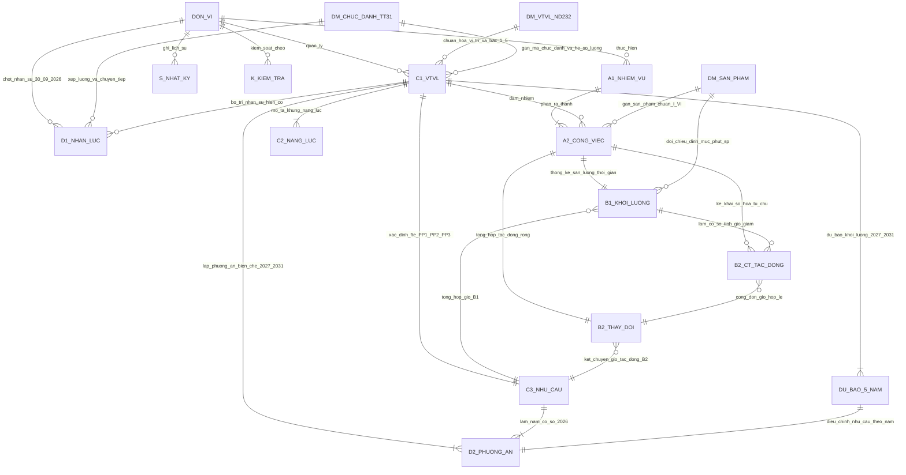

# Kiến trúc hệ thống Vị trí việc làm 360 — HCM-UTE (Chuẩn Hướng dẫn số 07-HD/BTCTW)

## 1. Bảo mật dữ liệu nội bộ (Zero Network Exposure)
- Toàn bộ tài liệu hướng dẫn gốc (`Tai lieu huong dan kem theo Huong dan so 07-HDVTVL/`) và kho kỹ năng (`20skill-van-phong-main/`) đã được khóa trong `.gitignore`, tuyệt đối không đẩy lên bất kỳ máy chủ hay kho lưu trữ từ xa nào.
- Mọi thao tác tách bộ biểu `.xlsx`, tạo gói `.zip`, đo bấm giờ, gộp phiếu và rà soát đều xử lý **100% cục bộ trên bộ nhớ trình duyệt (client-side)** bằng `xlsx` và `jszip`.

## 2. Quy trình 08 bước & Cấu trúc bộ biểu chuẩn 23 Sheet (Theo `01. HuongdanVTVL.docx`, `02-Bophuluc.docx` & `03. Bo bieu VTVL 25-10-2026.xlsx`)
- **Quy trình 08 bước nghiệp vụ (Bộ Phụ lục I–VIII):**
  1. **Bước 1:** Rà soát chức năng, nhiệm vụ và dữ liệu đã kê khai (`Phụ lục I, V` → `1. A1_NhiemVu`, đối chiếu `6. C1_VTVL`).
  2. **Bước 2:** Xác định công việc, công đoạn và sản phẩm đầu ra (`Phụ lục I, II, V` → `2. A2_CongViec`, `11. DM_SAN_PHAM`).
  3. **Bước 3:** Xác định số lượng sản phẩm và thời gian thực hiện (`Phụ lục III, IV, V` → `3. B1_KhoiLuong`).
  4. **Bước 4:** Xác định thay đổi công việc do chuyển đổi số, tự chủ, thuê dịch vụ (`Phụ lục III, IV, V` → `4. B2_CT_TacDong` → `5. B2_ThayDoi`).
  5. **Bước 5:** Đối chiếu danh mục VTVL, bản mô tả và khung năng lực (`Phụ lục II, V` → `6. C1_VTVL`, `7. C2_NangLuc`).
  6. **Bước 6:** Xác định số người cần thiết theo từng VTVL theo PP1, PP2, PP3 (`Phụ lục III, IV, V` → `8. C3_NhuCau`).
  7. **Bước 7:** Đối chiếu nguồn nhân lực hiện có (chốt `30/9/2026`) và lập phương án biên chế `2027–2031` (`Phụ lục III, IV, V` → `9. D1_NhanLuc`, `DU_BAO_5_NAM`, `10. D2_PhuongAn`).
  8. **Bước 8:** Kiểm tra chéo 10 biểu, xác nhận và gửi kết quả (`Phụ lục VI, VII, VIII` → `13. K_KiemTra`, `14. T_TienDo`, `15. S_NhatKy`).

- **Tệp đơn vị `[MÃ_ĐV]_K2526_v1_YYYYMMDD.xlsx` được khởi tạo gồm đúng 23 trang tính (bao gồm 10 biểu nghiệp vụ đánh số `1. A1` → `10. D2`):**
1. `HUONG_DAN` & `HD_DIEN_BIEU` (Thứ tự 12 bước nhập bảng; kỳ thống kê `01/10/2025–30/9/2026`; thời điểm chốt nhân lực `30/9/2026`; quỹ giờ chuẩn PP2 = `1.904 giờ/người/năm`; chế độ đặc thù Giảng viên/NCV = `1.760 giờ/người/năm`).
2. `1. A1_NhiemVu` (7 cột A–G)
3. `2. A2_CongViec` (8 cột A–H)
4. `3. B1_KhoiLuong` (19 cột A–S — tự động tra cứu `11. DM_SAN_PHAM`, tính `Giờ SP (tính)`, `Giờ tổng (tính)` và `Cảnh báo dữ liệu` ở cột R)
5. `4. B2_CT_TacDong` (19 cột A–S — chi tiết tác động số hóa, cải tiến quy trình, thuê dịch vụ, tự chủ, xã hội hóa)
6. `5. B2_ThayDoi` (9 cột A–I — tổng hợp giờ tác động ròng từ `B2_CT_TacDong`)
7. `6. C1_VTVL` (11 cột A–K — danh mục VTVL và kiểm tra quỹ giờ chuẩn PP2)
8. `7. C2_NangLuc` (7 cột A–G — bản mô tả công việc và khung năng lực)
9. `8. C3_NhuCau` (14 cột A–N — xác định nhu cầu nhân lực theo `PP1`, `PP2`, `PP3` và kết hợp)
10. `9. D1_NhanLuc` (11 cột A–K — nhân lực hiện có chốt tại `30/9/2026`)
11. `10. D2_PhuongAn` (14 cột A–N — phương án biên chế giai đoạn `2027–2031`)
12. `11. DM_SAN_PHAM` (10 cột A–J — danh mục sản phẩm chuẩn phân nhóm `I–VI`)
13. `12. CHIA_VUNG_CAP_XA`, `13. K_KiemTra` (6 chỉ tiêu kiểm soát tự động), `14. T_TienDo`, `15. S_NhatKy` (10 cột lịch sử phiên bản), `THAO_TAC_NHANH` (bảng tra nhanh quy trình 08 bước), `DM_06_NHOM`, `QUY_TAC_MA`, `DM_THAM_SO`, `DU_BAO_5_NAM` (10 cột A–J), `Can_cu_goi_y`.

## 3. Sơ đồ Thực thể – Liên kết (`erDiagram`) toàn hệ thống

## 4. Cơ chế gộp phiếu công việc ("Gộp vào B1/B2"), bảo toàn đa cá nhân & khóa đồng thời đa tiến trình

1. **Nhãn giao diện và đích ghi dữ liệu thực tế:**
   - Giao diện giữ nguyên nhãn nút thao tác và huy hiệu truyền thống **`"Gộp vào B1/B2"`** / **`"Đã gộp B1/B2"`**.
   - Về mặt kỹ thuật, thao tác gộp ghi trực tiếp dòng công việc và khối lượng giờ thực hiện vào **`Biểu A2` (`2. A2_CongViec`)** và **`Biểu B1` (`3. B1_KhoiLuong`)**, sau đó kích hoạt `recalculateGridFormulas` để tính lại dây chuyền công thức sang `Biểu C3` và `Biểu D2`.
   - **`Biểu B2` (`5. B2_ThayDoi`)** chỉ được liên kết và tính lại từ `Biểu B2_CT` (`4. B2_CT_TacDong`) khi đơn vị đã có dữ liệu kê khai tác động chuyển đổi số/tự chủ. Hệ thống tuyệt đối không sinh dữ liệu `B2` giả từ phiếu khảo sát công việc cá nhân.

2. **Bảo toàn nhiều cán bộ cùng kê khai một `maCongViec`:**
   - Khi hai hoặc nhiều cán bộ trong cùng đơn vị kê khai các phiếu khác nhau nhưng chọn cùng một mã công việc (`maCongViec`), cả `mergeApprovedTicketToUnitWorkbook` ([server-ticket-merge.ts](file:///Users/macaz/Documents/0.%20App/VTVL%20/src/services/storage/server-ticket-merge.ts)) và `recalculateGridFormulas` ([excel-grid-formulas.ts](file:///Users/macaz/Documents/0.%20App/VTVL%20/src/components/excel-grid/excel-grid-formulas.ts)) đều định danh dòng theo `sourceTicketId` của từng phiếu.
   - Chỉ khi cùng một phiếu (`sourceTicketId` trùng nhau) được nộp lại phiên bản mới (`v2`, `v3`...) thì dòng cũ của chính phiếu đó mới được cập nhật tại chỗ; phiếu của cán bộ khác giữ dòng độc lập và được cộng dồn chính xác tổng giờ chuẩn vào `Biểu B2` và `Biểu C3`.

3. **Khóa đồng thời đa tiến trình & chống ghi đè dữ liệu (`Optimistic Locking` + `Cross-Process Lock`):**
   - Ở chế độ lưu trữ cục bộ (`.data/`), `withUnitWorkbookLock` ([server-file-lock.ts](file:///Users/macaz/Documents/0.%20App/VTVL%20/src/services/storage/server-file-lock.ts)) sử dụng cơ chế tạo tệp khóa nguyên tử `fs.openSync(..., 'wx')` kết hợp xóa bộ nhớ đệm để tuần tự hóa các tiến trình gộp đồng thời, đồng thời kiểm tra `baseRevision` và loại bỏ việc gán đè `wb.data = snapshotWbData` trong khối `catch`.
   - Ở chế độ cơ sở dữ liệu Supabase, hàm `rpc_merge_work_survey_to_b1_b2` khóa cả dòng phiếu (`staff_work_tickets FOR UPDATE`) và dòng bảng tính đơn vị (`workbooks FOR UPDATE`), kiểm tra `p_expected_wb_revision` và dùng `PERFORM set_config('app.actor_id', ..., true)` (`SET LOCAL`) trong cùng một giao dịch.

## 5. Phân quyền danh mục VTVL (Biểu C1) & chế độ xem mặc định theo vai trò

1. **Phân quyền quản trị VTVL tại `3. C1_VTVL` và cổng phiếu công việc:**
   - **Quản trị viên hệ thống (`admin`):** Mở khóa trực tiếp `Biểu C1` trên toàn bộ **39 đơn vị**, được **thêm, sửa, xoá** mã/tên VTVL và chuyển đổi đơn vị công tác trên `/bang-tinh` (hoặc qua `?unit=MÃ_ĐV`).
   - **Lãnh đạo đơn vị (`unit_leader`):** Mở khóa trực tiếp `Biểu C1` trong phạm vi **đơn vị mình** (`caller.unitCode`), được **thêm, sửa, xoá** VTVL tại đơn vị và bị chặn `403 FORBIDDEN_CROSS_UNIT` khi thao tác sang đơn vị khác.
   - **Cán bộ – Giảng viên – Nhân viên (`staff`):** Ở chế độ **chỉ xem** trên `/bang-tinh` (`403 FORBIDDEN_VIEWER_WRITE` nếu gọi API sửa bảng tính); trên `/phieu-cong-viec`, nút **"Bảng tính toàn đơn vị"** trỏ mặc định tới `/bang-tinh?sheet=A2` (`2. A2_CongViec`) và mục chọn VTVL lấy trực tiếp từ danh mục `C1` mới nhất do Lãnh đạo đơn vị / Quản trị viên cập nhật.
   - Khi xóa một VTVL ở `Biểu C1`, `validateRowDeletion` chỉ chặn khi đã có phiếu công việc thực tế (`sourceTicketId`) gắn với mã VTVL đó tại `A2`/`B1`; đồng thời dọn sạch dữ liệu liên kết mẫu tại `C2`, `C3`, `D1`, `DU_BAO`, `D2`.

## 6. Cơ chế Thu hồi phê duyệt & Hủy/Xóa phiếu kê khai sai (tự động gỡ gộp A2/B1)

1. **Thu hồi phê duyệt (`action: 'revoke_approval'`):**
   - Áp dụng cho **Lãnh đạo đơn vị** (trong đơn vị mình, không tự thu hồi phiếu cá nhân của chính Lãnh đạo) và **Quản trị viên (`admin`)** khi phiếu đã ở trạng thái `Đã duyệt` nhưng phát hiện sai sót cần nhân viên sửa lại.
   - Yêu cầu nhập lý do thu hồi bắt buộc; hệ thống tự động gọi `unmergeTicketFromUnitWorkbook` ([server-ticket-unmerge.ts](file:///Users/macaz/Documents/0.%20App/VTVL%20/src/services/storage/server-ticket-unmerge.ts)) để gỡ dòng gắn `sourceTicketId` của phiếu khỏi `Biểu A2` và `Biểu B1` (giữ nguyên dòng của các cán bộ khác) và tính lại công thức đơn vị.
   - Phiếu chuyển về **`Yêu cầu bổ sung` (`changes_requested`)** để nhân viên chỉnh sửa và nộp lại phiên bản mới (`v2`, `v3`...), giữ nguyên lịch sử kiểm toán (`REVOKE_APPROVAL`).

2. **Hủy / xóa phiếu kê khai sai (`action: 'cancel_ticket'`):**
   - **Lãnh đạo đơn vị** hoặc **Quản trị viên (`admin`)** có thể hủy phiếu đã nộp hoặc đã duyệt do kê khai nhầm/trùng kèm lý do bắt buộc.
   - Hệ thống tự động gỡ gộp khỏi `Biểu A2/B1` (nếu đã gộp), xóa dữ liệu đề xuất phối hợp; xóa vật lý nếu là `Nháp` chưa có lịch sử, hoặc gắn cờ lưu trữ hủy (`isArchived = true`) để ẩn khỏi mọi danh sách & bộ đếm thống kê mà vẫn bảo toàn trigger bất biến của `work_survey_versions` và `work_survey_status_history`.

