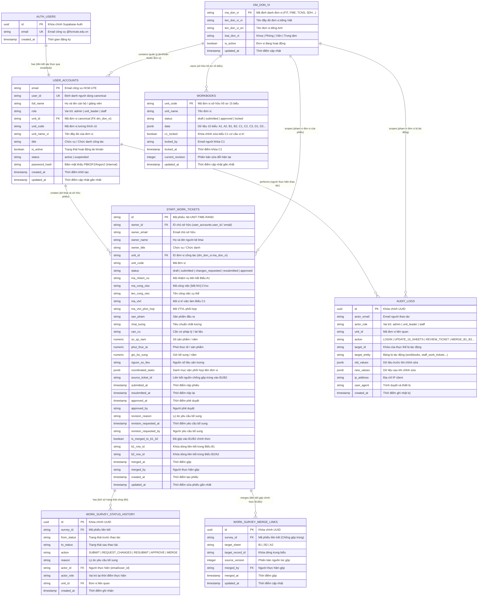

# Sơ đồ quan hệ thực thể (ERD) & Mô hình phân quyền HCM-UTE VTVL 360

Hệ thống: **HCM-UTE VTVL 360** (Trường Đại học Công nghệ Kỹ thuật TP.HCM)  
Căn cứ: Nghị định số 232/2026/NĐ-CP & Hướng dẫn số 07-HD/BTCTW  
Ngày cập nhật: 15/11/2026  

---

## 1. Sơ đồ thực thể quan hệ (Mermaid ERD)

---

## 2. Bảng đối chiếu thực thể tham khảo và thực tế

| Tên thực thể tham khảo | Bảng cơ sở dữ liệu thực tế | Chức năng nghiệp vụ |
|---|---|---|
| `AUTH_USERS` | `auth.users` | Quản lý định danh OAuth Supabase và email công vụ |
| `PROFILES` | `public.user_accounts` | Hồ sơ nhân sự, 3 vai trò cố định (`admin`, `unit_leader`, `staff`) và đơn vị trực thuộc |
| `UNITS` | `public.dm_don_vi` | Danh mục 48/51 đơn vị chính thức của Trường Đại học Công nghệ Kỹ thuật TP.HCM |
| `WORKBOOKS` | `public.workbooks` | Hồ sơ 15 biểu của từng đơn vị theo Hướng dẫn 07-HD/BTCTW |
| `WORK_SURVEYS` | `public.staff_work_tickets` | Phiếu khảo sát khối lượng công việc cá nhân liên thông A1-A2-B1-C1 |
| `WORK_SURVEY_STATUS_HISTORY` | `public.work_survey_status_history` | Nhật ký chuyển đổi 5 trạng thái vòng đời của phiếu cá nhân |
| `WORK_SURVEY_MERGE_LINKS` | `public.work_survey_merge_links` | Khóa liên kết nguồn idempotent ngăn chặn gộp trùng vào biểu B1/B2 |
| `AUDIT_LOGS` | `public.audit_logs` | Nhật ký kiểm toán bảo mật, lưu vết toàn bộ thao tác quan trọng trên hệ thống |
