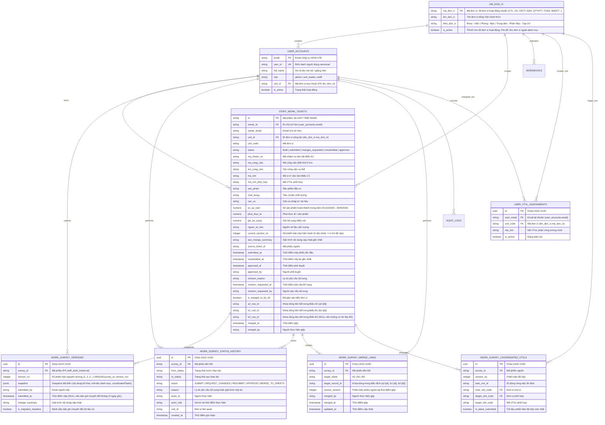

# Sơ đồ thực thể quan hệ (ERD) Quy trình duyệt, gộp và lịch sử phiên bản Phiếu công việc HCM-UTE VTVL 360

Hệ thống: **HCM-UTE VTVL 360** (Trường Đại học Công nghệ Kỹ thuật TP.HCM)  
Căn cứ: Nghị định số 232/2026/NĐ-CP, Hướng dẫn số 07-HD/BTCTW & Danh mục 39 đơn vị chuẩn  
Ngày cập nhật: 15/11/2026  

---

## 1. Sơ đồ thực thể quan hệ (Mermaid ERD)

---

## 2. Cơ chế ánh xạ (Mapping) thực tế từ Phiếu công việc sang các Biểu A2, B1, B2

| Biểu đích | Khóa dòng đích (`target_record_id`) | Trường trên `staff_work_tickets` | Quy tắc ánh xạ dữ liệu & Chống dữ liệu giả |
|---|---|---|---|
| **Biểu 2. A2_CongViec** | `a2-[ticket.id]` | `a2_row_id` | Ánh xạ danh mục công việc (`maCongViec`, `maNhiemVu`, `maVtvl`, `maVtvlPhoiHop`, `tenCongViec`, `sanPham`, `chatLuong`, `canCu`, `nguoiLapPhieu`) kèm `sourceVersion`. **Tuyệt đối không gọi biểu A2 là B2.** |
| **Biểu 4. B1_ThongKeSP** | `b1-[ticket.id]` | `b1_row_id` | Ánh xạ khối lượng sản phẩm và định mức thời gian (`maCongViec`, `maVtvl`, `soSpNam`, `phutThucTe`, `gioBoSung`, `nguonSoLieu`) kèm `sourceVersion`. Tự động tính lại công thức tổng giờ năm: \(\text{Tổng giờ} = \frac{\text{soSpNam} \times \text{phutThucTe}}{60} + \text{gioBoSung}\). |
| **Biểu 6. B2_DinhMuc** | `b2-[ticket.id]` *(chỉ khi có dữ liệu tác động B2)* | `b2_row_id` | Nếu phiếu cá nhân không có dữ liệu đo định mức tác động trực tiếp đến biểu B2, `b2_row_id` giữ giá trị `NULL` và **không tự sinh số liệu B2 giả**. |
| **Khóa chống trùng (`work_survey_merge_links`)** | `UNIQUE (survey_id, target_sheet, target_record_id)` | `is_merged_to_b1_b2` | Đảm bảo khi 1 phiếu sinh nhiều dòng hoặc được gộp lặp lại nhiều lần (re-merge), hệ thống cập nhật đúng dòng đích kèm `source_version` mới nhất mà không tạo bản ghi trùng lặp. |
