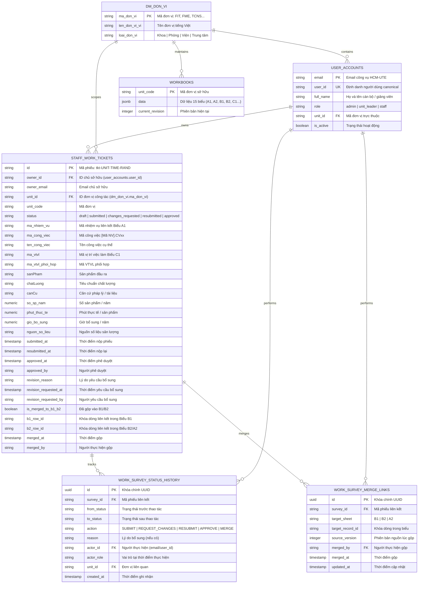

# Sơ đồ thực thể quan hệ (ERD) Quy trình duyệt và gộp Phiếu công việc HCM-UTE VTVL 360

Hệ thống: **HCM-UTE VTVL 360** (Trường Đại học Công nghệ Kỹ thuật TP.HCM)  
Căn cứ: Nghị định số 232/2026/NĐ-CP & Hướng dẫn số 07-HD/BTCTW  
Ngày cập nhật: 15/11/2026  

---

## 1. Sơ đồ thực thể quan hệ (Mermaid ERD)

---

## 2. So sánh kiến trúc CSDL trước và sau Migration

| Hạng mục | Trước Migration (`20261114`) | Sau Migration (`20261115030000`) |
|---|---|---|
| **Bảng phiếu công việc** | `staff_work_tickets` chỉ có các trường cơ bản về kê khai khối lượng. | Bổ sung đầy đủ 14 trường quản lý vòng đời: `submitted_at`, `resubmitted_at`, `approved_at`, `approved_by`, `revision_reason`, `revision_requested_at`, `revision_requested_by`, `merged_at`, `merged_by`, `b1_row_id`, `b2_row_id`, `is_merged_to_b1_b2`, `unit_id`, `owner_id`. |
| **Trạng thái phiếu** | Chỉ nhận 2 trạng thái: `Nháp` và `Đã nộp`. | Chuẩn hóa 5 trạng thái: `draft`, `submitted`, `changes_requested`, `resubmitted`, `approved` (kèm alias tiếng Việt tương thích ngược). |
| **Lịch sử phê duyệt** | Ghi nhận chung vào `audit_logs`. | Có bảng chuyên biệt `work_survey_status_history` lưu vết từng bước chuyển trạng thái, người duyệt, vai trò và lý do yêu cầu bổ sung. |
| **Gộp biểu B1/B2** | Lưu trực tiếp vào JSON của `workbooks`, chưa có bảng mapping độc lập. | Bảng `work_survey_merge_links` với `UNIQUE (survey_id, target_sheet)` đảm bảo không bao giờ sinh dòng trùng khi gộp nhiều lần. |
| **Bảo vệ Lãnh đạo tự duyệt** | Kiểm tra phân quyền ở API. | Bảo vệ 3 lớp: UI ẩn nút Duyệt, API trả mã `FORBIDDEN_SELF_REVIEW`, Database RPC kích hoạt Exception `ERRCODE = 42501`. |
