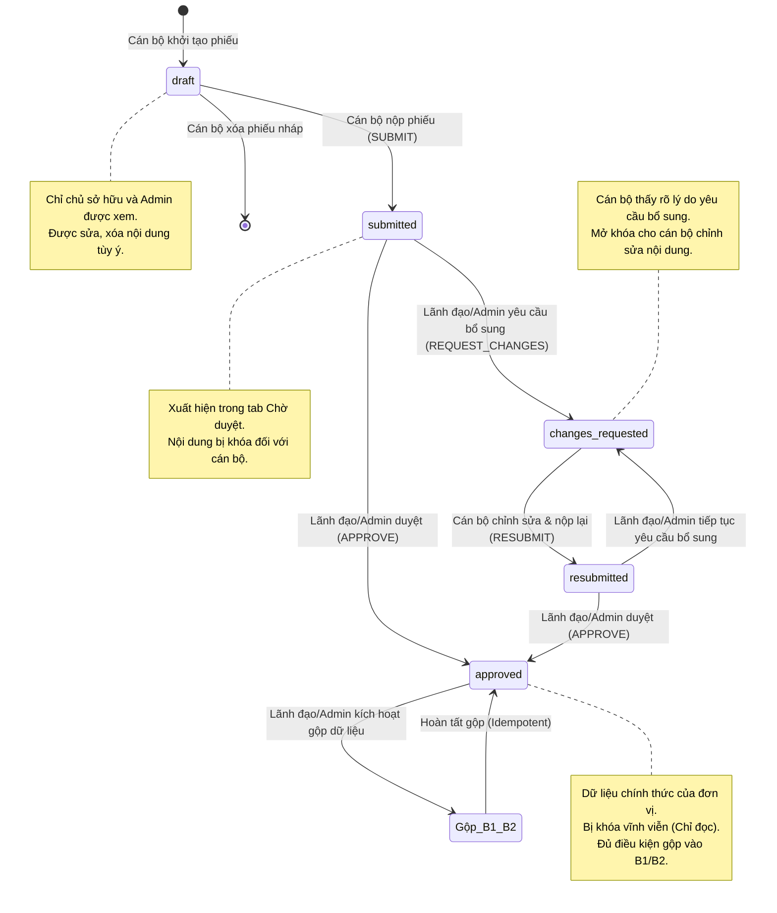

# Sơ đồ máy trạng thái (State Machine) Phiếu công việc cá nhân HCM-UTE

Hệ thống: **HCM-UTE VTVL 360** (Trường Đại học Công nghệ Kỹ thuật TP.HCM)  
Căn cứ: Nghị định số 232/2026/NĐ-CP & Hướng dẫn số 07-HD/BTCTW  
Ngày cập nhật: 15/11/2026  

---

## 1. Biểu đồ chuyển đổi trạng thái (State Machine Diagram)

---

## 2. Bảng ma trận chuyển đổi trạng thái hợp lệ

| Trạng thái hiện tại | Trạng thái tiếp theo | Thao tác (Action) | Tác nhân được phép | Điều kiện tiên quyết & Ràng buộc bảo mật |
|---|---|---|---|---|
| *(Khởi tạo)* | `draft` | `CREATE` | Cán bộ / Lãnh đạo / Admin | Phiếu được tạo cho chính mình (`owner_id = caller.email`) và đơn vị của mình. |
| `draft` | `submitted` | `SUBMIT` | Chủ sở hữu phiếu (`staff` / `unit_leader`) | Các trường bắt buộc (`maNhiemVu`, `maVtvl`, `tenCongViec`) phải đầy đủ. Ghi nhận `submitted_at = NOW()`. |
| `submitted` | `approved` | `APPROVE` | Lãnh đạo đơn vị (`unit_leader`) hoặc Admin | - Lãnh đạo chỉ duyệt phiếu thuộc đơn vị mình. - **Lãnh đạo CẤM tự duyệt phiếu của chính mình** (`FORBIDDEN_SELF_REVIEW`). Phiếu của Lãnh đạo phải do Admin/TCNS duyệt. - Ghi nhận `approved_by`, `approved_at = NOW()`. |
| `submitted` | `changes_requested` | `REQUEST_CHANGES` | Lãnh đạo đơn vị (`unit_leader`) hoặc Admin | - **Lý do yêu cầu bổ sung là bắt buộc** (không được rỗng). - Ghi nhận `revision_reason`, `revision_requested_by`, `revision_requested_at = NOW()`. |
| `changes_requested` | `resubmitted` | `RESUBMIT` | Chủ sở hữu phiếu | Cán bộ cập nhật lại nội dung theo yêu cầu và bấm nộp lại. Ghi nhận `resubmitted_at = NOW()`. |
| `resubmitted` | `approved` | `APPROVE` | Lãnh đạo đơn vị hoặc Admin | Tương tự nhánh `submitted -> approved`. |
| `resubmitted` | `changes_requested` | `REQUEST_CHANGES` | Lãnh đạo đơn vị hoặc Admin | Tương tự nhánh `submitted -> changes_requested`. |
| `approved` | `approved` *(Đã gộp)* | `MERGE_B1_B2` | Lãnh đạo đơn vị hoặc Admin | - Chỉ thực hiện khi phiếu ở trạng thái `approved`. - Sinh và liên kết dòng trong B1 (`b1-[id]`) và B2/A2 (`a2-[id]`). - Idempotent: Gộp lại thì cập nhật thay vì tạo trùng lặp. Ghi `merged_at`, `merged_by`. |

---

## 3. Các chuyển đổi BỊ CẤM (Invalid Transitions)

1. `draft` -> `approved`: Cấm duyệt thẳng từ bản nháp mà chưa qua bước nộp chính thức.
2. `draft` -> `changes_requested`: Cấm yêu cầu chỉnh sửa bản nháp chưa nộp.
3. `submitted` -> `draft`: Cấm tự hạ trạng thái phiếu đã nộp về nháp mà không qua quy trình trả lại/yêu cầu bổ sung.
4. `approved` -> `draft` / `changes_requested` / `submitted`: Phiếu sau khi duyệt trở thành bản ghi lịch sử chính thức, không được sửa đổi trực tiếp.
5. `changes_requested` -> `approved`: Phiếu yêu cầu bổ sung bắt buộc cán bộ phải nộp lại (`resubmitted`) trước khi Lãnh đạo có thể phê duyệt.
