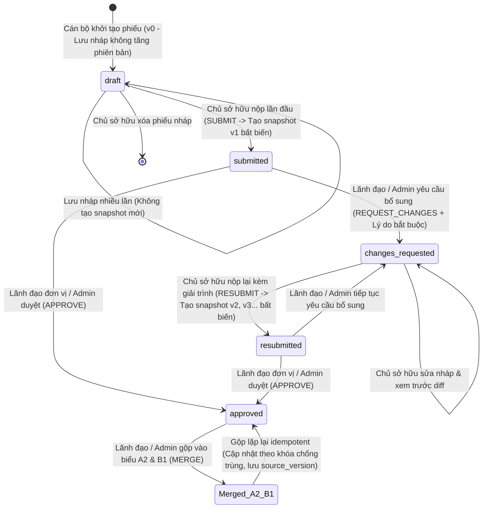

# Sơ đồ máy trạng thái (State Machine) & Quy tắc Phiên bản Phiếu công việc HCM-UTE

Hệ thống: **HCM-UTE VTVL 360** (Trường Đại học Công nghệ Kỹ thuật TP.HCM)  
Căn cứ: Nghị định số 232/2026/NĐ-CP & Hướng dẫn số 07-HD/BTCTW  
Ngày cập nhật: 15/11/2026  

---

## 1. Biểu đồ chuyển đổi trạng thái & sinh phiên bản (State Machine Diagram)

---

## 2. Bảng ma trận chuyển đổi trạng thái, phân quyền và phiên bản

| Trạng thái hiện tại | Trạng thái tiếp theo | Thao tác (Action) | Tác nhân được phép | Tác động Phiên bản (`work_survey_versions`) & Ràng buộc bảo mật |
|---|---|---|---|---|
| *(Khởi tạo)* / `draft` | `draft` | `SAVE_DRAFT` | Chỉ chủ sở hữu phiếu | - Chỉ chủ sở hữu và Admin được xem phiếu `draft`. - **Không tạo phiên bản nộp mới.** |
| `draft` | `submitted` | `SUBMIT` | Chỉ chủ sở hữu phiếu | - Kiểm tra đầy đủ các trường bắt buộc. - Khóa cạnh tranh (`FOR UPDATE` / mutex) chống bấm đúp. - **Tạo snapshot bất biến `v1`** trong cùng giao dịch với cập nhật trạng thái, `work_survey_status_history` và `audit_logs`. |
| `submitted` | `changes_requested` | `REQUEST_CHANGES` | Lãnh đạo cùng đơn vị hoặc Admin | - **Lý do yêu cầu bổ sung (`revision_reason`) là bắt buộc.** - Lãnh đạo không được tự xét duyệt phiếu của chính mình. - Mở khóa để chủ sở hữu chỉnh sửa. |
| `changes_requested` | `resubmitted` | `RESUBMIT` | Chỉ chủ sở hữu phiếu | - Chủ sở hữu nhập **“Giải trình nội dung đã cập nhật” (`change_summary`)** và xem trước bảng diff so với bản nộp gần nhất. - **Tạo snapshot bất biến `v2`, `v3`...** giữ nguyên các snapshot trước. |
| `submitted` / `resubmitted` | `approved` | `APPROVE` | Lãnh đạo cùng đơn vị hoặc Admin | - **Lãnh đạo đơn vị CẤM tự duyệt phiếu của chính mình (`FORBIDDEN_SELF_REVIEW`).** Phiếu của Lãnh đạo do Admin (TCNS) duyệt. - Khóa chỉnh sửa nội dung phiếu. |
| `approved` | `approved` *(Đã gộp)* | `MERGE` | Lãnh đạo cùng đơn vị hoặc Admin | - Chỉ phiếu `approved` mới được gộp. - Ánh xạ vào Biểu A2 (`a2-[id]`) và Biểu B1 (`b1-[id]`); không gọi A2 là B2; không sinh dữ liệu B2 giả. - Ghi `work_survey_merge_links` với `source_version = current_version_no`. |
