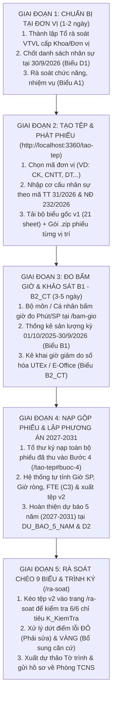
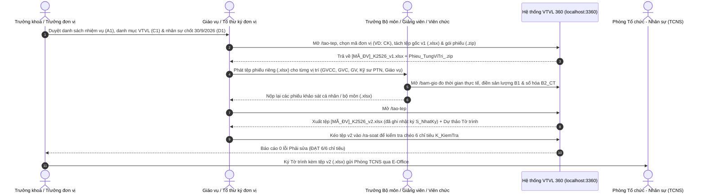

# Cẩm nang hướng dẫn toàn trình thực hiện Đề án Vị trí việc làm dành cho Khoa / Viện / Đơn vị thuộc HCM-UTE

Tài liệu này hướng dẫn **từng bước từ đầu đến cuối (End-to-End)** dành cho Lãnh đạo đơn vị (`Trưởng khoa`, `Viện trưởng`, `Trưởng phòng`, `Giám đốc trung tâm`), Tổ thư ký / Giáo vụ đơn vị và toàn thể Giảng viên, Viên chức tại **Trường Đại học Công nghệ Kỹ thuật TP.HCM (HCM-UTE)** khi thực hiện rà soát, xây dựng Đề án Vị trí việc làm và phương án biên chế giai đoạn `2027–2031`.

---

## 1. Bức tranh tổng quan: 3 căn cứ pháp lý và 5 giai đoạn tại một Khoa / Đơn vị

Mỗi Khoa / Đơn vị thực hiện rà soát dựa trên sự kết hợp đồng bộ của **3 văn bản pháp lý năm 2026**:
1. **Hướng dẫn số 07-HD/BTCTW** (`03. Bo bieu VTVL 25-10-2026.xlsx`): Quy định bộ biểu 21 trang tính (`1. A1_NhiemVu` đến `15. S_NhatKy` & `DU_BAO_5_NAM`), kỳ thống kê `01/10/2025–30/9/2026`, chốt nhân sự tại `30/9/2026`, quỹ giờ chuẩn `PP2 = 1.904 giờ/năm` (chế độ 40 giờ/tuần) hoặc `1.760 giờ/năm` (đặc thù giảng viên).
2. **Nghị định số 232/2026/NĐ-CP của Chính phủ**: Quy định chuẩn tên gọi 25 nhóm vị trí việc làm trường đại học theo **Phụ lục I** (Lãnh đạo, quản lý), **Phụ lục II** (Chuyên môn, nghiệp vụ — áp dụng **Bậc nghề nghiệp từ Bậc 2 đến Bậc 5**) và **Phụ lục III** (Hỗ trợ, phục vụ — áp dụng **Bậc nghề nghiệp từ Bậc 1 đến Bậc 5**).
3. **Thông tư số 31/2026/TT-BGDĐT ngày 14/4/2026 của Bộ GD&ĐT**: Quy định mã số chức danh và xếp lương nhà giáo (`V.07.01.01` Giảng viên cao cấp `A3.1: 6,20–8,00`; `V.07.01.02` Giảng viên chính `A2.1: 4,40–6,78`; `V.07.01.03` Giảng viên `A1: 2,34–4,98`) và điều khoản chuyển tiếp đối với **Trợ giảng (`V.07.01.23`)** tại khoản 5 Điều 15.

---

## 2. Phân công trách nhiệm trong nội bộ một Khoa / Đơn vị (Mô hình RACI)

Để không dồn toàn bộ khối lượng nhập liệu lên một người, mỗi Khoa / Đơn vị chia làm **3 nhóm vai trò phối hợp**:

| Vai trò tại Khoa / Đơn vị | Người đảm nhiệm | Nhiệm vụ cụ thể trong quy trình | Trang tính chịu trách nhiệm chính |
| :--- | :--- | :--- | :--- |
| **1. Chủ trì & Phê duyệt** | Trưởng khoa (`Dean`), Viện trưởng, Trưởng phòng (`Director`) | - Chốt danh mục nhiệm vụ (`A1`), danh mục vị trí việc làm (`C1`) và phương pháp tính (`PP1`, `PP2`, `PP1+PP2`). - Rà soát diện chuyển tiếp **Trợ giảng (`V.07.01.23`)** theo khoản 5 Điều 15 Thông tư 31/2026/TT-BGDĐT. - Duyệt dự báo 5 năm (`2027–2031`), phương án biên chế (`D2`) và ký **Tờ trình thẩm định**. | `1. A1_NhiemVu`, `6. C1_VTVL`, `8. C3_NhuCau`, `10. D2_PhuongAn`, `DU_BAO_5_NAM` |
| **2. Đầu mối điều phối & Tổng hợp** | Giáo vụ khoa, Chuyên viên tổng hợp đơn vị | - Thao tác trên `/tao-tep` để khởi tạo bộ biểu gốc `v1` và gói `.zip` phiếu khảo sát. - Đối chiếu danh sách nhân sự chốt ngày `30/9/2026` (`D1_NhanLuc`). - Thu phiếu từ các bộ môn/cá nhân, nạp gộp tại `/tao-tep#buoc-4` để sinh tệp `v2` và kiểm tra lỗi tại `/ra-soat`. | `2. A2_CongViec`, `9. D1_NhanLuc`, `13. K_KiemTra`, `14. T_TienDo`, `15. S_NhatKy` |
| **3. Thực hiện khảo sát & Đo định mức** | Trưởng bộ môn, Giảng viên (`V.07.01.01..03`), Kỹ sư PTN (`V.05.02.07`), Chuyên viên | - Sử dụng công cụ `/bam-gio` để đo thời gian thực hiện sản phẩm đầu ra (`Phút/SP`). - Kê khai sản lượng thực tế kỳ `01/10/2025–30/9/2026` (`B1_KhoiLuong`) kèm nguồn minh chứng (Kế hoạch giảng dạy, E-Office, UTEx LMS). - Kê khai số giờ giảm nhờ số hóa/cải tiến quy trình (`B2_CT_TacDong`). | `3. B1_KhoiLuong`, `4. B2_CT_TacDong`, `7. C2_NangLuc` |

---

## 3. Hướng dẫn chi tiết 5 bước thao tác thực tế (Ví dụ minh họa: Khoa Cơ khí — `CK`)

### Bước 1: Chuẩn bị số liệu đầu vào tại Khoa / Đơn vị (Trước khi mở phần mềm)
Tổ thư ký đơn vị chuẩn bị sẵn **3 thông tin gốc**:
1. **Danh sách viên chức, người lao động hiện có của đơn vị chốt tại thời điểm `30/9/2026`**, phân loại rõ theo mã số Thông tư 31/2026/TT-BGDĐT và Phụ lục Nghị định 232/2026/NĐ-CP:
   - Bao nhiêu **Giảng viên cao cấp** (`V.07.01.01` — Bậc 5 — `A3.1: 6,20–8,00`)?
   - Bao nhiêu **Giảng viên chính** (`V.07.01.02` — Bậc 4 — `A2.1: 4,40–6,78`)?
   - Bao nhiêu **Giảng viên** (`V.07.01.03` — từ Bậc 3 — `A1: 2,34–4,98`)?
   - Có nhân sự nào đang giữ ngạch **Trợ giảng (`V.07.01.23`)** bổ nhiệm trước `31/3/2026` hoặc tuyển dụng theo đề án trước `30/6/2026` không?
   - Bao nhiêu **Viên chức Thiết bị, thí nghiệm** (`V.05.02.07` — Bậc 2 đến Bậc 3) và **Giáo vụ / Hành chính - Tổng hợp** (`01.003` — Bậc 2 đến Bậc 4)?
2. **Thống kê sản lượng đầu ra trong 12 tháng (`01/10/2025–30/9/2026`):**
   - Tổng số lớp học phần đại học/sau đại học đã giảng dạy; số bài báo khoa học/đề tài NCKH; số ca thực hành phòng thí nghiệm/xưởng; số hồ sơ học vụ/văn bản E-Office đã xử lý.
3. **Các hoạt động chuyển đổi số đã áp dụng tại đơn vị:**
   - Ví dụ: Giảng dạy kết hợp trên hệ thống **UTEx LMS**, chấm thi trắc nghiệm tự động, duyệt văn bản và học vụ qua **E-Office** giúp giảm bao nhiêu phút trên mỗi sản phẩm.

---

### Bước 2: Khởi tạo bộ biểu 21 sheet của Đơn vị và tách gói phiếu `.zip`
1. Mở trình duyệt truy cập **`http://localhost:3360/tao-tep`**.
2. **Tại Mục 1 (Chọn mẫu khối đơn vị):** Chọn khối phù hợp (ví dụ: **Khối Khoa, Viện đào tạo** đối với `CK`, `CNTT`, `DDT`... hoặc **Khối Phòng, Ban chức năng** đối với `TCNS`, `DT`, `KHTC`...).
3. **Tại Mục 2 (Chọn đơn vị & Cấu hình nhân lực D1):**
   - Chọn đơn vị từ danh sách 48 đơn vị (ví dụ: `[CK] Khoa Cơ khí`).
   - Nhập số lượng nhân sự thực tế chốt tại `30/9/2026` vào cột **Số người (D1)** cho từng nhóm vị trí.
4. **Tại Mục 3 (Tách bộ biểu chuẩn 21 sheet):**
   - Đánh dấu chọn **"Thêm gói phiếu riêng từng vị trí (.zip)"**.
   - Bấm nút **"Tạo bộ biểu cho CK"**.
   - Tải về 3 tệp:
     - `CK_K2526_v1_YYYYMMDD.xlsx`: **Tệp đơn vị gốc (21 sheet)** do Giáo vụ / Tổ thư ký giữ.
     - `Phieu_KhaoSat_B1_B2_CK_K2526_YYYYMMDD.xlsx`: Phiếu khảo sát tổng hợp của đơn vị.
     - `Phieu_TungViTri_CK_K2526_YYYYMMDD.zip`: Gói chứa các tệp `.xlsx` tách riêng cho từng vị trí việc làm (`CK-QL-01`, `CK-CM-01`, `CK-CM-02`, `CK-CM-03`, `CK-KT-01`, `CK-HC-01`) để gửi cho các Bộ môn / Cá nhân.

---

### Bước 3: Bấm giờ đo định mức thực tế và điền Phiếu khảo sát theo thứ tự chuẩn
- **Đối với Giảng viên / Kỹ sư PTN / Giáo vụ:**
  1. Mở **`http://localhost:3360/bam-gio`**, chọn đơn vị (`CK`) và vị trí của mình để bấm đồng hồ đo thời gian thực hiện công việc thực tế hoặc nhập các phiên đo, sau đó bấm **"Xuất phiếu cá nhân (.xlsx)"**.
  2. Hoặc mở trực tiếp tệp phiếu của vị trí mình trong gói `.zip`, cập nhật tại sheet **`3. B1_KhoiLuong`**:
     - **Cột C (`Số SP/năm`):** Nhập sản lượng thực tế kỳ `01/10/2025–30/9/2026`.
     - **Cột D (`Trung bình phút/SP`):** Nhập số phút thực tế thực hiện 1 sản phẩm.
     - **Cột H (`Nguồn SL`) & Cột I (`Nguồn thời gian`):** Ghi rõ nguồn xác thực (ví dụ: *"Bảng phân công giảng dạy NH 2025–2026"*, *"Thống kê E-Office CK"*, *"Biên bản bấm giờ thực tế ngày 07/11/2026"*). **Lưu ý:** Không để nguyên dòng chữ gợi ý mẫu `(gợi ý – chưa đo)`.
     - **Cột S (`Giải trình khác chuẩn`):** Nếu `Phút/SP thực tế` (Cột D) chênh lệch quá `30%` so với `Phút/SP chuẩn` (Cột N), bắt buộc ghi rõ lý do đặc thù tại Cột S (ví dụ: *"Học phần thí nghiệm tích hợp dự án xưởng cơ khí chính xác"*).
  3. Tại sheet **`4. B2_CT_TacDong`**, kiểm tra hoặc bổ sung các công đoạn đã số hóa (Phút trước → Phút sau) để làm căn cứ tính giờ giảm chuyển đổi số.

---

### Bước 4: Nạp gộp các phiếu vào Tệp đơn vị và kiểm tra 12 bước công thức
1. Sau khi thu lại các phiếu `.xlsx` từ các Bộ môn / Cá nhân, Giáo vụ khoa mở **`http://localhost:3360/tao-tep#buoc-4`** (Mục **Bước 4: Nạp và gộp phiếu khảo sát vào tệp đơn vị**):
   - **Ô 1:** Chọn tệp gốc `CK_K2526_v1_YYYYMMDD.xlsx`.
   - **Ô 2:** Chọn tất cả các tệp phiếu khảo sát / phiếu bấm giờ đã thu về.
   - Bấm **"Nạp & Gộp phiếu vào tệp đơn vị"**.
2. Hệ thống tự động:
   - Đối chiếu xung đột, cập nhật `Số SP/năm`, `Phút/SP`, tính lại `Giờ SP (tính)` và `Giờ tổng (tính)` tại `3. B1_KhoiLuong`.
   - Kết chuyển giờ ròng sang `8. C3_NhuCau` để tính **Người quy đổi PP2** (`Giờ ròng / 1.904` hoặc `Giờ ròng / 1.760`).
   - Ghi nhận toàn bộ lịch sử thay đổi (Giá trị cũ → Giá trị mới) vào sheet **`15. S_NhatKy`** và nâng tên tệp lên phiên bản **`v2`** (`CK_K2526_v2_YYYYMMDD.xlsx`).
3. Bấm **"Tải dự thảo Tờ trình"** ngay phía trên để lấy mẫu Tờ trình thẩm định Đề án VTVL đã điền sẵn số liệu của đơn vị.

---

### Bước 5: Rà soát chéo 9 biểu trên hệ thống trước khi trình ký nộp Phòng TCNS
1. Mở trang **`http://localhost:3360/ra-soat`**.
2. Kéo tệp `CK_K2526_v2_YYYYMMDD.xlsx` vào khung kiểm tra và bấm **"Chạy rà soát 9 biểu"**.
3. Đối chiếu bảng kết quả 3 cấp độ cảnh báo:
   - **Mức 1 — Phải sửa ngay (Màu đỏ):** Ví dụ thiếu sản lượng (`Cột C <= 0`), thiếu thời gian (`Cột D <= 0`), trùng mã nhân sự tại `D1_NhanLuc`, tổng giờ cá nhân vượt quỹ giờ năm, hoặc còn dẫn chiếu `Thông tư 40/2020/TT-BGDĐT` đã hết hiệu lực. **Bắt buộc phải sửa về `0 lỗi` trước khi nộp.**
   - **Mức 2 — Cần bổ sung căn cứ (Màu vàng):** Ví dụ Cột H/I của `B1_KhoiLuong` vẫn để dòng chữ `(gợi ý – chưa đo)` mà chưa ghi tên văn bản/hệ thống xác thực.
   - **Mức 3 — Nên xem lại (Màu xanh):** Ví dụ vị trí **Trợ giảng (`V.07.01.23`)** thuộc diện rà soát chuyển tiếp theo khoản 5 Điều 15 Thông tư 31/2026/TT-BGDĐT, hoặc Cột D tại `7. C2_NangLuc` cần kiểm tra lại **Bậc nghề nghiệp (Bậc 1–5)** theo Nghị định 232/2026/NĐ-CP.
4. Khi báo cáo đạt **`0 lỗi Phải sửa`**, Trưởng đơn vị ký **Tờ trình thẩm định Đề án Vị trí việc làm** kèm tệp `.xlsx` hoàn chỉnh gửi về **Phòng Tổ chức - Nhân sự (`TCNS`)** qua hệ thống E-Office.

